```mermaid
flowchart TD
    task-format["task-format: document the contracts-only mode in the plan format<br/>files: skills/writing-dag-plans/plan-format.md"]:::done
    task-check["task-check: enforce rule 14 in plan-state<br/>files: skills/writing-dag-plans/plan-state, tests/plan-state/plan-state.test.sh"]:::done
    task-quality["task-quality: let the quality rules read Contracts sections<br/>files: skills/writing-dag-plans/plan-quality.md"]:::done
    task-authoring["task-authoring: point the authoring steps at the contracts-only mode<br/>files: skills/writing-dag-plans/SKILL.md"]:::done
    task-lenses["task-lenses: tell the plan-audit lenses the omission is deliberate<br/>files: skills/auditing-artifacts/lenses-plan.md"]:::done
    task-conventions["task-conventions: write the repo's conventions file<br/>files: CLAUDE.md"]:::done

    classDef done fill:#90ee90,stroke:#333
    classDef running fill:#87ceeb,stroke:#333
    classDef ready fill:#fffacd,stroke:#333
    classDef failed fill:#ffb6c1,stroke:#333
    classDef skipped fill:#d3d3d3,stroke:#333,stroke-dasharray: 5 5
```

## Context

The D1 experiment compares a normal plan with a plan whose tasks carry `## Contracts`
instead of `## Implementation`. Today the plugin's own rules refuse the second kind
(H7), and the checks that read code blocks (H8, H9, H10, step 6.5) would go quiet on it.
This plan adds an experimental contracts-only mode, switched on by one frontmatter key,
and gives the repo a `CLAUDE.md` that states its conventions, so both experiment arms'
implementers see them.

Plans without the key must behave exactly as before.

Out of scope here, and built outside the repo until the experiment's report is written,
so that neither experiment arm can read them: the measurement script, the headless runner,
the pinned plugin copy, the hidden portability check and the blind-review prompt.

The shared contract every task below states in full:

- Frontmatter key `implementation:`, optional, values `full` or `contracts-only`; absent
  means `full`. Experimental.
- Under `contracts-only`, every task without `is_wiring_task: true` has a
  `## Contracts` section and no `## Implementation` section.
- A `## Contracts` section holds signatures only: function names and arguments, command
  usage, exit codes, output and file formats. No function bodies, no test code. Fenced
  code blocks are allowed for the signatures.
- Validation rule 14 enforces the first two points.

## Tasks

## Task: document the contracts-only mode in the plan format

```yaml
id: task-format
depends_on: []
files:
  - skills/writing-dag-plans/plan-format.md
status: done
```

Add the experimental `implementation:` frontmatter key, the `## Contracts` section and
validation rule 14 to `skills/writing-dag-plans/plan-format.md`.

## Implementation

Three insertions and one edit:

1. In the frontmatter skeleton under "Top-of-file structure", after the `child:` line:

```yaml
implementation: full                    # OPTIONAL. full | contracts-only. Default full. EXPERIMENTAL (D1 experiment): contracts-only replaces each task's ## Implementation with ## Contracts. See "Contracts-only plans".
```

2. After the "Wiring tasks" subsection, a new subsection:

```markdown
### Contracts-only plans (experimental)

A plan whose frontmatter sets `implementation: contracts-only` replaces each task's
`## Implementation` with a `## Contracts` section. Contracts hold signatures only:
function names and arguments, command usage, exit codes, output and file formats. No
function bodies, no test code. Fenced code blocks are allowed for the signatures. The
implementer decides how; the task states what must hold. Wiring tasks stay exempt.
The mode exists for the D1 experiment and is not a default.
```

3. After rule 13 in "Validation rules":

```markdown
14. **`implementation:` mode** — `implementation:`, when present in frontmatter, MUST be `full` or `contracts-only`. Under `contracts-only`, every task without `is_wiring_task: true` MUST have a `## Contracts` section and MUST NOT have a `## Implementation` section. Any other case → refuse, naming the field and its value, or the task and the section.
```

4. Edit the two rule-range sentences below the list: "Rules #7–#13" becomes "Rules #7–#14",
   and "enforces rules 1–5 and 7–13" becomes "enforces rules 1–5 and 7–14".

Failing check before the change (prints nothing, exits 1):

```bash
rg -n '^14\. \*\*`implementation:` mode\*\*' skills/writing-dag-plans/plan-format.md
```

## Acceptance criteria

- `rg -c '^14\. \*\*`implementation:` mode\*\*' skills/writing-dag-plans/plan-format.md` prints `1`.
- The frontmatter skeleton contains a line starting `implementation: full` that names both values `full | contracts-only` and the word `EXPERIMENTAL`.
- A `### Contracts-only plans (experimental)` heading exists, and its paragraph contains the sentence "No function bodies, no test code."
- `rg -c 'rules 1–5 and 7–14' skills/writing-dag-plans/plan-format.md` prints `1`, and `rg -c 'rules 1–5 and 7–13' skills/writing-dag-plans/plan-format.md` prints nothing.

Test file: none (the `rg` checks above).

## Task: enforce rule 14 in plan-state

```yaml
id: task-check
depends_on: []
files:
  - skills/writing-dag-plans/plan-state
  - tests/plan-state/plan-state.test.sh
status: done
review_mode: split
```

Make `plan-state check` enforce rule 14: frontmatter `implementation:`, when present, is
`full` or `contracts-only`; under `contracts-only` every task without
`is_wiring_task: true` has a `## Contracts` section and no `## Implementation` section.
A plan without the key must produce exactly the output it produces today.

## Implementation

The scanner already sees every heading line outside fences. Record the two sections per
task, then check them in `check()`:

```awk
# in the pass-1 scanner, just before: if (line ~ /^##? /) pend = 0
if (cur && line ~ /^## Implementation[ \t]*$/) secimpl[cur] = 1
if (cur && line ~ /^## Contracts[ \t]*$/) seccon[cur] = 1

# in check(), after the rule 12 line
if ("implementation" in fmset) {
  if (!inset(fm["implementation"], "full contracts-only")) viol(14, "implementation is " fm["implementation"])
  else if (fm["implementation"] == "contracts-only") for (t = 1; t <= nt; t++) {
    if (val[t, "is_wiring_task"] == "true") continue
    k = val[t, "id"]
    if (!(t in seccon)) viol(14, k " has no ## Contracts section")
    if (t in secimpl) viol(14, k " has an ## Implementation section")
  }
}
```

Also change the usage comment's "validate rules 1-5 and 7-13" to "validate rules 1-5 and 7-14".

Failing test, added to `tests/plan-state/plan-state.test.sh` before the RESULT line in the
file's existing style (`clean_plan`, `ps`, `has`, `chk`):

```bash
echo
echo "T21: rule 14, contracts-only plans"
clean_plan "$tmp/r21.md"; sed -i 's/^created: 2026-11-12$/created: 2026-11-12\nimplementation: contracts-only/' "$tmp/r21.md"
out="$(ps check "$tmp/r21.md" 2>&1)"; rc=$?
chk "contracts-only plan without Contracts sections exits 1" "$rc" "1"
has "names the task" "$out" "rule 14: task-a has no ## Contracts section"
```

## Acceptance criteria

- `implementation: bogus` in frontmatter: `check` exits 1 and prints `plan-state: rule 14: implementation is bogus`.
- `implementation: contracts-only` on a plan whose task `task-a` has neither section: `check` exits 1 and prints `plan-state: rule 14: task-a has no ## Contracts section`.
- Under `contracts-only`, a task with both sections exits 1 and prints `plan-state: rule 14: <id> has an ## Implementation section` and no "has no ## Contracts" line for that task.
- Under `contracts-only`, a plan where every task has `## Contracts` and no `## Implementation` exits 0 with no output; a task with `is_wiring_task: true` and neither section adds no rule 14 line.
- A `## Contracts` or `## Implementation` heading inside a fenced code block is not counted (a fixture task whose only `## Contracts` line sits inside a fence still gets the "has no ## Contracts section" line).
- `implementation: full`, and a plan with no `implementation:` key, both exit 0 with no output on the clean fixture, including when a task has a `## Contracts` section.
- Every pre-existing case T1–T20 still passes, and the full suite ends with `0 failed` under both `sh` and the alt shell the suite already uses.

Test file: tests/plan-state/plan-state.test.sh.

## Task: let the quality rules read Contracts sections

```yaml
id: task-quality
depends_on: []
files:
  - skills/writing-dag-plans/plan-quality.md
status: done
```

Teach `skills/writing-dag-plans/plan-quality.md` the contracts-only mode, so H7 accepts
`## Contracts` under `implementation: contracts-only`, and the rules that read
`## Implementation` code blocks read `## Contracts` code blocks instead rather than going
quiet. The shared contract: frontmatter `implementation:` is `full` (default) or
`contracts-only`; under `contracts-only` every non-wiring task has `## Contracts`
(signatures, command usage, exit codes, output and file formats; no function bodies, no
test code) and no `## Implementation`.

## Implementation

1. In the H7 row, append:

```markdown
Under `implementation: contracts-only` (`plan-format.md` rule 14), the requirement is a `## Contracts` subsection with at least one fenced code block holding signatures, and a `## Implementation` subsection is a violation.
```

2. Directly below the hard-rules table, a new paragraph:

```markdown
**Contracts-only plans (experimental).** When frontmatter sets `implementation: contracts-only`, wherever H8, H9, H10, S12 and S13 read code blocks under `## Implementation`, they read code blocks under `## Contracts` instead. Contract sequencing is still checked, from signatures rather than sketches. A rule that needs a function body to decide (S13's declaration lookup) decides from the signature and the acceptance criteria, and says so when it cannot.
```

Failing check before the change (prints nothing, exits 1):

```bash
rg -n '^\*\*Contracts-only plans \(experimental\)\.\*\*' skills/writing-dag-plans/plan-quality.md
```

## Acceptance criteria

- `rg -c '^\*\*Contracts-only plans \(experimental\)\.\*\*' skills/writing-dag-plans/plan-quality.md` prints `1`, and that paragraph names H8, H9, H10, S12 and S13.
- The H7 table row contains `implementation: contracts-only` and the phrase "`## Implementation` subsection is a violation".
- The "Bad: missing Implementation subsection (refused, H7)" example is unchanged.

Test file: none (the `rg` checks above).

## Task: point the authoring steps at the contracts-only mode

```yaml
id: task-authoring
depends_on: []
files:
  - skills/writing-dag-plans/SKILL.md
status: done
```

Update `skills/writing-dag-plans/SKILL.md` so an author writing a contracts-only plan
is told where the steps differ. Shared contract: frontmatter `implementation:` is `full`
(default) or `contracts-only`; under `contracts-only` every non-wiring task has
`## Contracts` (signatures only; no function bodies, no test code) and no
`## Implementation`; rule 14 enforces this.

## Implementation

Three edits:

1. Step 6's rule list gains a bullet after the `default_implementer` sentence:

```markdown
   - `implementation:`, when present, is `full` or `contracts-only`. Under
     `contracts-only` (experimental), every non-wiring task has `## Contracts` and no
     `## Implementation` (rule 14).
```

2. Step 6.5's first sentence, "Walk each task's `## Implementation` block", becomes
   "Walk each task's `## Implementation` block (`## Contracts` in a contracts-only plan)".

3. In step 7's H-rule list, "`## Implementation` subsection presence" becomes
   "`## Implementation` subsection presence (`## Contracts` under `implementation: contracts-only`)".

Failing check before the change (prints nothing, exits 1):

```bash
rg -n 'rule 14' skills/writing-dag-plans/SKILL.md
```

## Acceptance criteria

- `rg -c 'rule 14' skills/writing-dag-plans/SKILL.md` prints `1`, on the step 6 bullet.
- Step 6.5's first sentence contains "`## Contracts` in a contracts-only plan".
- Step 7's H-rule list contains "`## Contracts` under `implementation: contracts-only`".

Test file: none (the `rg` checks above).

## Task: tell the plan-audit lenses the omission is deliberate

```yaml
id: task-lenses
depends_on: []
files:
  - skills/auditing-artifacts/lenses-plan.md
status: done
```

Add a section to `skills/auditing-artifacts/lenses-plan.md` so gate-2 lenses auditing a
contracts-only plan neither report the missing implementation nor ask for one, and still
audit what such a plan must get right. Shared contract: frontmatter `implementation:` is
`full` (default) or `contracts-only`; under `contracts-only` every non-wiring task has
`## Contracts` (signatures, command usage, exit codes, output and file formats; no function
bodies, no test code) and no `## Implementation`.

## Implementation

A new section between the lens table and the first lens (`## \`coverage\``):

```markdown
## Contracts-only plans (experimental)

When the plan's frontmatter sets `implementation: contracts-only`, each task carries
`## Contracts` (signatures, command usage, exit codes, output and file formats) instead
of `## Implementation`. The missing implementation is deliberate. No lens reports its
absence, and no lens asks for function bodies, test code, or a prescribed algorithm or
idiom.

What changes per lens:

- `context-sufficiency` asks whether the acceptance criteria and contracts are enough for
  an implementer to know *what* must hold, not *how* to build it.
- `coherence` compares each task's acceptance criteria against its own contracts, and
  contracts that two tasks share against each other.
- `dag-integrity`, `coverage`, `grounding`, `charter`, `verifiability` and `ambiguity`
  apply unchanged.

A finding that can only be closed by prescribing how is still reported, tagged
`needs-implementation`, so the plan's author can close it with an acceptance criterion
instead.
```

Failing check before the change (prints nothing, exits 1):

```bash
rg -n '^## Contracts-only plans \(experimental\)' skills/auditing-artifacts/lenses-plan.md
```

## Acceptance criteria

- `rg -c '^## Contracts-only plans \(experimental\)' skills/auditing-artifacts/lenses-plan.md` prints `1`, and the heading sits after the lens table and before `## \`coverage\``.
- The section names all eight lenses: `context-sufficiency` and `coherence` with changed questions, the other six as unchanged.
- The section contains the tag `needs-implementation` and the sentence "The missing implementation is deliberate."
- The eight lens sections below are unchanged (`git diff` on the file shows additions only).

Test file: none (the `rg` and `git diff` checks above).

## Task: write the repo's conventions file

```yaml
id: task-conventions
depends_on: []
files:
  - CLAUDE.md
status: done
model_hint: cheap
```

Create a root `CLAUDE.md` stating the conventions this repo already follows but has never
written down, so implementers (who receive `CLAUDE.md` with every task) follow them.
Every statement must be true of the repo today; check each against the files named.

## Implementation

```markdown
# parallel-dag-execution

A Claude Code plugin: skills, agents and commands that write, audit and execute DAG plans.

## Conventions

- The helper scripts (`skills/writing-dag-plans/plan-state`,
  `skills/executing-dag-plans/git-commit-safe`,
  `skills/auditing-artifacts/resolve-declared-paths`) are POSIX sh and awk. They must
  run under dash as well as bash, and under gawk, mawk and busybox awk: no bash-only
  syntax, no gawk-only functions (`gensub`, `strftime`, `asort`), no `\x` escapes in awk.
- Line endings are LF. An extensionless script must be listed in `.gitattributes` with
  `text eol=lf`.
- Each script has a suite under `tests/<suite>/`. Run a test file with
  `bash tests/<suite>/<file>.test.sh`; it ends with `RESULT: N passed, M failed` or a
  `PASS` line, and exits non-zero on failure.
- Skills and prompts are written in plain words. Rules state what to do and why, once.
- Commits use conventional prefixes (feat, fix, docs, test, refactor, chore); the body
  says why.
```

Failing check before the change (exits 1: no file):

```bash
test -f CLAUDE.md
```

## Acceptance criteria

- `CLAUDE.md` exists at the repo root and is at most 40 lines.
- It names gawk, mawk, busybox and dash, and the three helper script paths, each of which exists (`test -f` on all three exits 0).
- The test command it gives runs: every `tests/*/*.test.sh` file, run in the stated form, exits 0.
- Every extensionless script it names appears in `.gitattributes` with `text eol=lf`.

Test file: none (the checks above).
