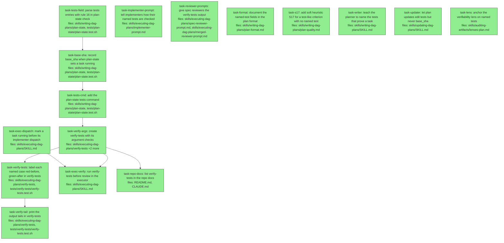

## Context

E3 (backlog item in `docs/proposals/2026-11-12-charters-and-waves-backlog.md`): a task can name
the test cases that prove it in a `tests:` list. `plan-state` parses the list, validates it
(rule 16), records the commit a task started from in `base_sha:` (rule 17) when the task is set
`running`, and prints what a checker needs (`plan-state tests`). A new helper, `verify-tests`,
builds a before tree and an after tree as detached worktrees, runs each named case's suite in
both, and labels every case. The executor marks a task `running` before dispatch, runs
`verify-tests` after the implementer reports and before any review, and treats a failed check
as a fix round. The prompts, the plan format, the quality rules, the updater and the gate-2
`verifiability` lens learn about named tests.

The spec is frozen (gate 1 READY). Every task restates the parts of it that it needs, because
the reviewers see only the task body.

### Names this plan fixes

Tasks restate these where they need them.

- The helper is `skills/executing-dag-plans/verify-tests`; its suite is
  `tests/verify-tests/verify-tests.test.sh`.
- `verify-tests` finds `plan-state` at `../writing-dag-plans/plan-state` relative to its own
  directory and runs it with `sh`.
- Reviewer prompt templates receive the check's output through a placeholder named
  `{verify_tests_output}`.
- The new soft heuristic is **S17 — Test-like criterion with no named test**.
- Error messages of `verify-tests` that the spec does not pin have the form
  `verify-tests: <id>: <reason>` on stderr.

### Shape

The three `plan-state` tasks share the script and its suite, so they form a chain (the
`tests:` field and rule 16; then `base_sha:` and rule 17; then the `tests` command). The three
`verify-tests` tasks share the new script and its suite and form a second chain after it. The
documentation and prompt tasks describe interfaces the spec pins exactly, so most of them are
roots and run while the scripts are being built. Two wait for `verify-tests` to exist because
their text names its path: the executor's verify step (which also follows the dispatch-order
change in the same `SKILL.md`) and the repo docs.

Script tasks list the script together with its suite under `tests/<suite>/`. They are two path
prefixes but one unit: this repo keeps each script's suite beside it, and a test-first task
needs both. The first `verify-tests` task also owns `.gitattributes`, because the repo rule is
that an extensionless script is listed there when it is created.

### Calls made while planning

No one was available to answer questions. These are the decisions taken, and why.

1. **This plan does not use `tests:` fields itself.** The executor that runs it is the plugin
   as it was before this plan, which ignores `tests:`, so entries would be unchecked
   decoration. Acceptance criteria still name each new suite case exactly, in prose, so a
   later plan could adopt them.
2. **Plan file name.** The path the user gave, `docs/superpowers/plans/2026-11-17-named-tests.md`,
   not the default `-dag.md` suffix.
3. **Review modes.** `default_review_mode: merged` for the documentation and prompt tasks,
   which are small text edits checked by `rg`; the six script tasks set `review_mode: split`.
   `task-verify-tests` sets `model_hint: opus`: it owns worktrees, signal handling and the two
   empirical unknowns.
4. **Empirical unknowns become acceptance criteria on `task-verify-tests`.** The spec's Audit
   record names two: whether a fresh worktree lacks untracked or ignored dependencies, and which
   signal reaches `verify-tests` when the Bash tool times out. Gate-1 round 3 also deferred to
   this plan "trap exit on a second signal or failed cleanup". All three are criteria there. The
   findings are written into the script's header comment, where the next reader of the script
   finds them.
5. **Second signal and failed cleanup** (the spec leaves both open). While the trap cleans up,
   further INT, TERM and HUP are ignored, and the exit stays 2. If removing a worktree or the
   temporary directory fails, on any path, `verify-tests` prints
   `verify-tests: <id>: cleanup failed` on stderr and exits 2, even when every entry was ok: a
   leftover worktree is a tooling fault the controller must see. Stdout is unchanged by this.
6. **A test command that is interrupted** is run in the background and waited for with `wait`,
   because a POSIX shell runs a trap only after the foreground command returns. The trap stops
   the `sh -c` process it started before removing the worktrees.
7. **If the Bash tool's timeout sends a signal the trap cannot catch** (KILL), the
   registrations are cleared by the next run's `git worktree prune`, which the spec already
   requires, once the temporary directory left under `${TMPDIR:-/tmp}` is gone; until then they
   stay listed. `verify-tests` never removes a worktree it did not create, because another
   `verify-tests` may be using it at the same time. The implementer reports
   that as DONE_WITH_CONCERNS so the executor text can be amended by `/update`; this plan does
   not guess the answer in advance.
8. **"S1–S16" references.** Places that enumerate the rule set (`writing-dag-plans/SKILL.md`,
   `updating-dag-plans/SKILL.md`, `plan-quality.md`, `README.md`) become S1–S17. Places that say
   a plan "has already passed H1–H11 and S1–S16" (`auditing-artifacts/SKILL.md`,
   `commands/audit-plan.md`) stay: the claim is still true, and those passages are about lens
   overlap, which S17 does not change.
9. **`CLAUDE.md` lists the POSIX helper scripts.** `verify-tests` is one, so it joins the list,
   in the repo-docs task.
10. **Usage text.** `plan-state`'s `usage()` prints the header through its `# Exit:` line by
    address (`sed -n '3,/^# Exit:/p'`) instead of a fixed line range, so the next added
    subcommand cannot silently drop the last line again.

### Conventions (from `CLAUDE.md`)

The helper scripts are POSIX sh and awk and must run under dash and bash, and under gawk, mawk
and busybox awk: no bash-only syntax, no `gensub`, `strftime` or `asort`, no `\x` escapes in
awk. Line endings are LF, and an extensionless script is listed in `.gitattributes` with
`text eol=lf`. A suite ends with `RESULT: N passed, M failed` and exits non-zero on failure;
suites may use `rg`, scripts may not. Commits use conventional prefixes and the body says why.

## Tasks

## Task: parse tests entries with rule 16 in plan-state check

```yaml
id: task-tests-field
depends_on: []
files:
  - skills/writing-dag-plans/plan-state
  - tests/plan-state/plan-state.test.sh
status: done
review_mode: split
```

Teach `plan-state`'s parser the per-task `tests:` list and the three plan-level test fields,
and add check rule 16. Spec: "The plan format" and "Validation rules", rule 16.

The task field, block form only:

```yaml
tests:
  - tests/plan-state/plan-state.test.sh :: round on "2" counts to 3
```

How an entry is read:

- **Block form only**, one entry per indented `- ` line. Any value on the `tests:` line itself
  (`tests: [a :: b]`, or a scalar) is a violation, because case names may contain commas. The
  `tests:` key line is comment-stripped like every key line, so `tests:   # cases` is block
  form with no value.
- **The raw entry** is the text after the `-` and the whitespace after it, taken literally to
  the end of the line, with a trailing CR and trailing whitespace removed. Unlike `files:` items,
  nothing is a comment (` #` is part of the text), quotes are not stripped, and commas do not
  split it.
- The raw entry splits at the first ` :: ` (space, two colons, space). `<file>` is the part
  before it, trimmed, with every leading `./` removed. `<case>` is the part after it, trimmed.
- Two entries are **the same** when their normalised `(<file>, <case>)` pairs are equal, so
  `./a.sh :: x` repeats `a.sh :: x`.

Plan-level fields, read as other frontmatter values are (comment-stripped, then unquoted):
`test_command` (default `bash {file}`), `test_pass_prefix` (default `"PASS: "`),
`test_fail_prefix` (default `"FAIL: "`). A default applies only when the key is absent; a key
present with an empty value is empty.

Rule 16. Each item is one line on stdout, and `check` exits 1:

- `plan-state: rule 16: <id> tests entry "<entry>" is not "<file> :: <case>"` — the entry has
  no ` :: `, or an empty `<file>` or `<case>`. `<entry>` is the raw entry.
- `plan-state: rule 16: <id> test file <file> is not in its files:` — `<file>` is not among
  the same task's normalised `files:` items.
- `plan-state: rule 16: <id> tests entry "<entry>" is repeated` — once per repeat of an
  earlier entry in the same task.
- `plan-state: rule 16: <id> tests must be a block list` — a value on the `tests:` line.
- `plan-state: rule 16: test_command has no {file}`
- `plan-state: rule 16: test_pass_prefix is empty` and `plan-state: rule 16: test_fail_prefix is empty`

Put the task-level checks in one awk function that returns how many fail and prints the lines
only when asked, so the later `plan-state tests` command reuses the same predicate rather than
a copy. Keep the plan-level checks in a second function for the same reason. A plan with no
`tests:` and no test fields gives exactly today's output.

## Implementation

```sh
# awk, in yamlline(): the tests key and its items (sketch)
#   if (k == "tests") { if (v != "") tline[cur] = 1; else ylist = "tests"; return }
#   ... in the "- item" branch, before stripc():
#   if (ylist == "tests") { raw = substr(l, RLENGTH + 1); sub(/[ \t\r]+$/, "", raw)
#     nte[cur]++; traw[cur, nte[cur]] = raw; return }

# awk: split one raw entry into TF and TC; 0 when it does not split
function tsplit(raw,   i) {
  i = index(raw, " :: "); if (!i) return 0
  TF = trim(substr(raw, 1, i - 1)); while (substr(TF, 1, 2) == "./") TF = substr(TF, 3)
  TC = trim(substr(raw, i + 4))
  return TF != "" && TC != ""
}
# awk: rule 16 for task t; prints when say is 1, returns the number of failures
function r16task(t, say,   e, n, k, seen, j, inf) {
  n = 0; k = val[t, "id"]
  if (tline[t]) { n++; if (say) viol(16, k " tests must be a block list") }
  for (e = 1; e <= nte[t]; e++) {
    if (!tsplit(traw[t, e])) { n++; if (say) viol(16, k " tests entry \"" traw[t, e] "\" is not \"<file> :: <case>\""); continue }
    inf = 0; for (j = 1; j <= nf[t]; j++) if (fil[t, j] == TF) inf = 1
    if (!inf) { n++; if (say) viol(16, k " test file " TF " is not in its files:") }
    if ((TF SUBSEP TC) in seen) { n++; if (say) viol(16, k " tests entry \"" traw[t, e] "\" is repeated") }
    seen[TF SUBSEP TC] = 1
  }
  return n
}
```

```bash
# tests/plan-state/plan-state.test.sh: a failing case first
cp "$tmp/clean.md" "$tmp/t16a.md"
awk '{ print } /^  - tests\/hook.test.sh/ && !d { d = 1; print "tests:"; print "  - tests/hook.test.sh no separator" }' "$tmp/t16a.md" > "$tmp/t16a.t" && mv "$tmp/t16a.t" "$tmp/t16a.md"
out="$(ps check "$tmp/t16a.md" 2>&1)"; rc=$?
chk "rule 16: entry without :: exits 1" "$rc" "1"
has "rule 16: entry without :: is named" "$out" 'rule 16: task-c tests entry "tests/hook.test.sh no separator" is not "<file> :: <case>"'
```

The sketch's helper names and the fixture-building lines are illustrative; build the fixture
plans however the suite already does (`clean_plan` writes a three-task plan).

## Acceptance criteria

Each criterion is a case in `tests/plan-state/plan-state.test.sh` with the quoted name, and each
name appears once in the suite.

- "rule 16: entry without :: is named": an entry with no ` :: ` gives the not-`<file> :: <case>`
  line quoting the raw entry, and `check` exits 1.
- "rule 16: empty case is refused": `  - a.sh ::   ` (trailing spaces) gives the same line with
  the raw entry `a.sh ::`, since trailing whitespace is removed before splitting.
- "rule 16: raw entry keeps # and quotes": an entry `t/a.sh :: x # "y", z` in a task whose
  `files:` holds `t/a.sh` gives no rule 16 line, and a second identical entry gives
  `tests entry "t/a.sh :: x # "y", z" is repeated` — the comment, quotes and comma survived.
- "rule 16: ./ repeat is the same entry": entries `./t/a.sh :: x` then `t/a.sh :: x` give
  exactly one `is repeated` line.
- "rule 16: test file outside files: is named": `other.sh :: x` gives
  `rule 16: <id> test file other.sh is not in its files:`.
- "rule 16: inline tests value is refused": `tests: [t/a.sh :: x]` gives
  `rule 16: <id> tests must be a block list`; "rule 16: comment on tests line is block form":
  `tests:   # cases` followed by a valid entry gives no rule 16 line.
- "rule 16: test_command without {file}": frontmatter `test_command: make test` gives
  `rule 16: test_command has no {file}`.
- "rule 16: empty pass prefix": `test_pass_prefix: ""` gives `rule 16: test_pass_prefix is
  empty`; "rule 16: empty fail prefix" does the same for `test_fail_prefix`.
- "rule 16: valid tests pass check": a plan with valid entries, `test_command: sh {file}` and
  both prefixes quoted gives no output and exit 0. This is the positive companion of every
  case above: the same fixture minus one defect is clean.
- The existing suite still passes: `bash tests/plan-state/plan-state.test.sh` ends with
  `RESULT: N passed, 0 failed`.

Test file: `tests/plan-state/plan-state.test.sh`.

## Task: record base_sha when plan-state sets a task running

```yaml
id: task-base-sha
depends_on: [task-tests-field]
files:
  - skills/writing-dag-plans/plan-state
  - tests/plan-state/plan-state.test.sh
status: done
review_mode: split
```

When `plan-state set <plan> <id> running` moves a task that has no `base_sha:`, write
`base_sha: <sha>` on the line after its `status:` line, and add check rule 17. `base_sha` is the
commit the task started from, so a later check can tell the task's own change from what came
before. Spec: "`plan-state` changes" and rule 17.

Behaviour of `set ... running`, in this order:

1. The existing checks run first: an illegal move or an unknown or repeated id is refused
   exactly as today (same messages, exit 2), and git is not called.
2. When the task already has a `base_sha:`, git is not called and the field is left untouched.
   The first value is kept through every later status change, including a resume's reset of
   `running` to `ready` and the next `running`, so a re-dispatched task's own earlier commits
   still count as its change.
3. Otherwise `<sha>` is the full 40-character output of
   `git -C <plan's directory> rev-parse HEAD`, with git's stderr discarded.
4. When git fails (no repository, or no commit yet):
   - a task **with** `tests:` entries is refused with exit 2 and the plan's bytes unchanged:
     `plan-state: refused <id>: cannot read HEAD for base_sha` on stderr;
   - a task **without** them is set `running` as today, with no `base_sha:` and no message.
5. The inserted line has the `status:` line's indentation and its line ending (a CRLF plan
   stays CRLF), as `round` already does for `review_rounds:`.

No other status writes or changes `base_sha:`. Rule 17 in `check`: `base_sha`, when present,
is 7 to 40 lowercase hex characters, else `plan-state: rule 17: <id> base_sha is <value>`.

## Implementation

```sh
# shell, in the set branch: decide in awk first, then ask git only when needed (sketch)
set)
  [ "$#" -eq 2 ] || usage
  case "$2" in pending|ready|running|done|failed|skipped) ;; *) echo "plan-state: unknown status $2" >&2; exit 2 ;; esac
  base=""
  if [ "$2" = running ]; then
    # MODE=setq runs apply() without writing and prints "<has base_sha> <has tests>", e.g. "0 1"
    q=$(awk -v MODE=setq -v SETID="$1" -v SETST="$2" -v CAP="$CAP" "$PROG" "$plan") || exit "$?"
    case "$q" in
      "0 "*) base=$(git -C "$(dirname -- "$plan")" rev-parse HEAD 2>/dev/null) || base=""
             if [ -z "$base" ] && [ "${q#0 }" = 1 ]; then
               echo "plan-state: refused $1: cannot read HEAD for base_sha" >&2; exit 2
             fi ;;
    esac
  fi
  emit "$1" "$2" "" "" "$base" ;;

# awk, in the emit block: after printing the status line of the task being set,
#   if (BASESHA != "" && FNR == stl[su]) { print; ind = $0; sub(/[^ \t].*$/, "", ind)
#     print ind "base_sha: " BASESHA (($0 ~ /\r$/) ? "\r" : ""); next }
# awk, in check(): rule 17
#   v = val[t, "base_sha"]
#   if (has[t, "base_sha"] && (v !~ /^[0-9a-f]+$/ || length(v) < 7 || length(v) > 40)) viol(17, k " base_sha is " v)
```

```bash
# tests/plan-state/plan-state.test.sh: a failing case first
g="$tmp/gitrepo"; mkdir "$g"; git -C "$g" init -q
git -C "$g" -c user.email=t@t.test -c user.name=t commit -q --allow-empty -m base
clean_plan "$g/plan.md"; ps set "$g/plan.md" task-b ready >/dev/null 2>&1
ps set "$g/plan.md" task-b running >/dev/null 2>&1
chk "base_sha: written on first running" "$(awk '/^base_sha:/ { print $2 }' "$g/plan.md")" "$(git -C "$g" rev-parse HEAD)"
```

`clean_plan` marks task-a `done`, so task-b may move to `ready`. The `setq` mode name and the
extra `emit` argument are illustrative.

## Acceptance criteria

Each criterion is a case in `tests/plan-state/plan-state.test.sh` with the quoted name, and each
name appears once in the suite.

- "base_sha: written on first running": in a git repository with one commit, `set ... running`
  on a ready task exits 0 and the task's YAML gains `base_sha: ` followed by the 40-character
  output of `git -C <repo> rev-parse HEAD`, on the line right after `status: running`.
- "base_sha: kept through resume": after a second commit, `set ... ready` then `set ...
  running` leaves `base_sha:` at the first commit's SHA, and the task has exactly one
  `base_sha:` line.
- "base_sha: refused without HEAD for a task with tests": in a directory that is not a git
  repository, `set ... running` on a ready task with a valid `tests:` entry exits 2, stderr
  contains `plan-state: refused <id>: cannot read HEAD for base_sha`, and the plan's bytes are
  unchanged (`cmp` against a copy taken before).
- "base_sha: no repository, no tests, moves as today": the same move on a task without
  `tests:` exits 0, writes `status: running`, writes no `base_sha:` line, and prints nothing.
- "base_sha: illegal move refused before git": `set ... running` on a `done` task in a
  directory with no repository exits 2 with the existing `refused <id>: done -> running`
  message, not the `cannot read HEAD` one.
- "base_sha: CRLF plan stays CRLF": in a git repository, the move on a CRLF plan inserts a
  `base_sha:` line that ends in CR, like its neighbours.
- "rule 17: bad base_sha is named": `base_sha: XYZ` gives
  `plan-state: rule 17: <id> base_sha is XYZ` and exit 1; "rule 17: short and uppercase
  refused": `abc12` and `ABCDEF1` each give a rule 17 line; "rule 17: 7 and 40 hex pass": a
  7-character and a 40-character lowercase hex value give no output.
- The existing suite still passes: `bash tests/plan-state/plan-state.test.sh` ends with
  `RESULT: N passed, 0 failed`.

Test file: `tests/plan-state/plan-state.test.sh`.

## Task: add the plan-state tests command

```yaml
id: task-tests-cmd
depends_on: [task-base-sha]
files:
  - skills/writing-dag-plans/plan-state
  - tests/plan-state/plan-state.test.sh
status: done
review_mode: split
```

Add `plan-state tests <plan> <id>`, which prints everything `verify-tests` needs about one task
so that `plan-state` stays the only plan parser. Update the script header and `usage()`. Spec:
"`plan-state tests <plan> <id>`".

Output on stdout, in this order, then exit 0:

```
base <base_sha, or - when absent>
command <test_command>
pass <test_pass_prefix>
fail <test_fail_prefix>
file <path>
test <file>\t<case>
```

- `command`, `pass` and `fail` carry the plan-level values with the defaults applied
  (`bash {file}`, `PASS: `, `FAIL: `). Each value runs from after the single space following
  the keyword to the end of the line, untrimmed, so the default `pass` line is `pass PASS: `
  with a trailing space.
- One `file` line per item of the task's `files:`, normalised as `plan-state` already does
  (unquoted, comment-stripped, leading `./` removed, inline lists split), in order. None when
  the task has no `files:`.
- One `test` line per entry, in `tests:` order, with the normalised `<file>` and `<case>` and a
  tab between them. None when the task has no `tests:`.

Exit 2 with nothing on stdout. The checks run in this order, and the first group that fails is
the only one reported:

1. fewer than two arguments to `plan-state` (the subcommand and the plan): the usage text on
   stderr, as for every subcommand (the existing top-of-script check);
2. the plan cannot be read (missing, a directory, or unreadable):
   `plan-state: cannot read <plan>` (the existing check);
3. not exactly one id after the plan: the usage text on stderr;
4. the id is unknown (`plan-state: no task with id <id>`) or not unique
   (`plan-state: id <id> is not unique; run: plan-state check`);
5. a plan-level rule 16 check fails: every failing plan-level rule 16 line, in the order rule
   16 lists them (`test_command`, then `test_pass_prefix`, then `test_fail_prefix`), exactly as
   `check` prints them, on stderr;
6. this task fails any task-level rule 16 check (an entry check, or a value on its `tests:`
   line): `plan-state: <id> has a bad tests entry; run: plan-state check`. Other tasks' entries
   do not affect it.

Steps 5 and 6 call the two rule 16 functions `task-tests-field` wrote, not copies of them.

Header: add the line
`#   plan-state tests  <plan> <id>          print a task's named tests and test settings`, and
change `check`'s line to `validate rules 1-5 and 7-17, status values, mermaid block` (ASCII
hyphen). `usage()` prints the whole header through its `# Exit:` line; use
`sed -n '3,/^# Exit:/p'` so the range follows the header. Update the existing usage assertion
in the suite (`usage lists rules 1-5 and 7-15`) to the new text.

## Implementation

```sh
# awk, END: MODE == "tests" (sketch). Buffer nothing to stdout until every check has passed.
function testsout(   n, t, u, e, j, cmdv, pv, fv) {
  n = 0; for (t = 1; t <= nt; t++) if (val[t, "id"] == TID) { n++; u = t }
  if (n != 1) { err(n ? "id " TID " is not unique; run: plan-state check" : "no task with id " TID); exit 2 }
  if (r16plan(0)) { r16plan(2); exit 2 }          # 2: print the lines to stderr
  if (r16task(u, 0)) { err(TID " has a bad tests entry; run: plan-state check"); exit 2 }
  cmdv = ("test_command" in fmset) ? fm["test_command"] : "bash {file}"
  pv = ("test_pass_prefix" in fmset) ? fm["test_pass_prefix"] : "PASS: "
  fv = ("test_fail_prefix" in fmset) ? fm["test_fail_prefix"] : "FAIL: "
  print "base " (has[u, "base_sha"] ? val[u, "base_sha"] : "-")
  print "command " cmdv; print "pass " pv; print "fail " fv
  for (j = 1; j <= nf[u]; j++) print "file " fil[u, j]
  for (e = 1; e <= nte[u]; e++) { tsplit(traw[u, e]); print "test " TF "\t" TC }
}
# shell
#   tests) [ "$#" -eq 1 ] || usage; awk -v MODE=tests -v TID="$1" -v CAP="$CAP" "$PROG" "$plan" ;;
```

```bash
# tests/plan-state/plan-state.test.sh: a failing case first
out="$(ps tests "$tmp/t-ok.md" task-c 2>/dev/null)"; rc=$?
chk "tests: prints the whole record" "$rc:$out" "0:base -
command bash {file}
pass PASS: 
fail FAIL: 
file tests/hook.test.sh
test tests/hook.test.sh	round one"
```

## Acceptance criteria

Each criterion is a case in `tests/plan-state/plan-state.test.sh` with the quoted name, and each
name appears once in the suite.

- "tests: prints the whole record": for a task with `base_sha:`, two `files:` items (one
  written `./x`), and two entries, stdout equals exactly the six-kind record above with the base
  value, the defaults, both `file` lines (the `./` removed) and both `test` lines in order,
  each `test` line holding one tab; exit 0.
- "tests: pass line keeps its trailing space": the default `pass` line is byte-equal to
  `pass PASS: ` (11 characters); with `test_fail_prefix: "not ok "` the `fail` line is
  `fail not ok `.
- "tests: no base_sha prints base -": a task without `base_sha:` prints `base -` first.
- "tests: no tests prints no test lines": a task without `tests:` prints the four header lines
  and its `file` lines, no `test` line, exit 0.
- "tests: missing id is usage": `plan-state tests <plan>` exits 2, stdout empty, stderr holds the
  usage text (contains `plan-state tests`); the same with two ids.
- "tests: missing plan reports cannot read": `plan-state tests nope.md task-a` exits 2 with
  `plan-state: cannot read nope.md` on stderr — the read check comes before the id count, so
  `plan-state tests nope.md` (no id) also gives `cannot read`, not usage.
- "tests: unknown id": exit 2, stdout empty, stderr contains `plan-state: no task with id zz`;
  "tests: repeated id": stderr contains `is not unique; run: plan-state check`.
- "tests: plan-level rule 16 lines on stderr": a plan with `test_command: make` and
  `test_pass_prefix: ""` exits 2 with stdout empty and stderr holding both rule 16 lines,
  `test_command` first.
- "tests: bad entry in this task": exit 2, stdout empty, stderr contains
  `plan-state: <id> has a bad tests entry; run: plan-state check`; "tests: bad entry in another
  task is ignored": the same plan queried for a clean task exits 0.
- "usage lists tests": the usage text contains `plan-state tests`; the renamed existing case
  "usage lists rules 1-5 and 7-17" finds `rules 1-5 and 7-17`; "usage ends at Exit": the last
  line of the usage text starts with `Exit:`.
- The existing suite still passes: `bash tests/plan-state/plan-state.test.sh` ends with
  `RESULT: N passed, 0 failed`.

Test file: `tests/plan-state/plan-state.test.sh`.

## Task: create verify-tests with its argument checks

```yaml
id: task-verify-args
depends_on: [task-tests-cmd]
files:
  - skills/executing-dag-plans/verify-tests
  - tests/verify-tests/verify-tests.test.sh
  - .gitattributes
status: done
review_mode: split
```

Create the helper `skills/executing-dag-plans/verify-tests` in POSIX sh and awk, beside
`git-commit-safe`, with its suite `tests/verify-tests/verify-tests.test.sh`, and list the
script in `.gitattributes` with `text eol=lf` under the "Extensionless shell script" block.
This task builds steps 1-3 of the spec's "What it does"; `task-verify-tests` adds the trees.
Spec: "`verify-tests` (new helper)".

**Usage:** `verify-tests <plan> <id>`. Any other argument count prints the header's usage
lines on stderr and exits 2.

1. Run `plan-state tests <plan> <id>` with `sh`, using the `plan-state` at
   `../writing-dag-plans/plan-state` relative to the directory of `verify-tests` itself, and
   read everything from its output; never open the plan. When it exits 2, relay its stderr
   and exit 2. The task's status does not matter.
2. With no `test` lines: print `verify-tests: <id>: no named tests` on stdout and exit 0.
3. With `base -`: print `verify-tests: <id>: no base_sha (set the task running first)` on
   stderr and exit 2.

The repository (`git -C <plan's directory> rev-parse --show-toplevel`) is looked up only after
these three steps, so a plan outside any repository whose task has no `tests:` still gets step
2's exit 0. Read `plan-state tests` output with `IFS= read -r`, so the `pass` and `fail` values
keep their trailing spaces, and split each `test` line at its tab. After step 3, this task
stops with a stub that prints `verify-tests: <id>: not built yet` on stderr and exits 2;
`task-verify-tests` replaces it.

The header comment carries a usage line, one line per exit code (0 every entry ok or no
entries; 1 at least one entry failed; 2 usage, plan-state, base_sha, git or interrupt), and the
sentence "It never writes to the plan, touches the shared working tree or index, or commits."

The suite follows `tests/plan-state/plan-state.test.sh`'s shape: `ok`, `bad`, `chk`, `has`,
`hasnt` helpers that print `  PASS: <name>` and `  FAIL: <name> (...)`, a temporary directory
removed on exit, `RESULT: N passed, M failed` at the end, and a non-zero exit on failure. Run
the script as `sh "$SCRIPT"`, and run the argument cases a second time under dash when it is
installed, as the plan-state suite does with `ALTSH`.

## Implementation

```sh
#!/usr/bin/env sh
# verify-tests — check that a task's named test cases were red before its change and green after.
# Usage: verify-tests <plan> <id>
# Exit: 0 every entry ok, or no entries; 1 at least one entry failed;
#       2 usage, plan-state tests error, no base_sha, git failure, or interrupt.
# It never writes to the plan, touches the shared working tree or index, or commits.
set -u
usage() { sed -n '3,5p' "$0" | sed 's/^# \{0,1\}//' >&2; exit 2; }
[ "$#" -eq 2 ] || usage
plan=$1; id=$2
here=$(cd "$(dirname -- "$0")" && pwd)
ps="$here/../writing-dag-plans/plan-state"
work=$(mktemp -d) || exit 2
rec="$work/rec"; perr="$work/err"
if ! sh "$ps" tests "$plan" "$id" > "$rec" 2> "$perr"; then cat "$perr" >&2; rm -rf "$work"; exit 2; fi
base=""; ntest=0
while IFS= read -r line; do
  case $line in
    "base "*) base=${line#base } ;;
    "test "*) ntest=$((ntest + 1)) ;;
  esac
done < "$rec"
if [ "$ntest" -eq 0 ]; then echo "verify-tests: $id: no named tests"; rm -rf "$work"; exit 0; fi
if [ "$base" = "-" ]; then echo "verify-tests: $id: no base_sha (set the task running first)" >&2; rm -rf "$work"; exit 2; fi
echo "verify-tests: $id: not built yet" >&2; rm -rf "$work"; exit 2
```

```bash
#!/usr/bin/env bash
# tests/verify-tests/verify-tests.test.sh: a failing case first
REPO="$(cd "$(dirname "$0")/../.." && pwd)"
SCRIPT="$REPO/skills/executing-dag-plans/verify-tests"
# ... helpers as in the plan-state suite ...
out="$(sh "$SCRIPT" "$tmp/notests.md" task-a 2>"$tmp/e")"; rc=$?
chk "args: no named tests exits 0" "$rc:$out" "0:verify-tests: task-a: no named tests"
```

The scratch directory used before step 4 is an implementation choice; `task-verify-tests` may
restructure it.

## Acceptance criteria

Each criterion is a case in `tests/verify-tests/verify-tests.test.sh` with the quoted name, and
each name appears once in the suite.

- "args: no arguments is usage": `verify-tests` with 0, 1 or 3 arguments exits 2 with stdout
  empty and stderr containing `verify-tests <plan> <id>`.
- "args: plan-state error is relayed": an unknown id exits 2 with stdout empty and stderr
  containing `plan-state: no task with id zz`; "args: unreadable plan is relayed": a missing
  plan exits 2 with stderr containing `plan-state: cannot read`.
- "args: no named tests exits 0": a task with no `tests:` in a plan inside a temporary
  directory that is not a git repository prints exactly `verify-tests: <id>: no named tests` on
  stdout and exits 0.
- "args: no base_sha exits 2": a task with a valid `tests:` entry and no `base_sha:` exits 2,
  stdout empty, stderr containing
  `verify-tests: <id>: no base_sha (set the task running first)`.
- "args: runs under dash": when `dash` is installed, the four cases above give the same exit
  codes under `dash "$SCRIPT"`; when it is not, the suite prints one `NOTE:` line and runs them
  under `sh` instead.
- `git check-attr eol -- skills/executing-dag-plans/verify-tests` prints
  `skills/executing-dag-plans/verify-tests: eol: lf`, and the committed script has no CR byte
  (`git show HEAD:skills/executing-dag-plans/verify-tests | od -c | rg -c '\\r'` prints nothing).
- `bash tests/verify-tests/verify-tests.test.sh` ends with `RESULT: N passed, 0 failed` and
  exits 0.

Test file: `tests/verify-tests/verify-tests.test.sh`.

## Task: label each named case red-before, green-after in verify-tests

```yaml
id: task-verify-tests
depends_on: [task-verify-args]
files:
  - skills/executing-dag-plans/verify-tests
  - tests/verify-tests/verify-tests.test.sh
status: done
review_mode: split
model_hint: opus
```

Replace the stub in `verify-tests` with steps 4-9 of the spec: build an after tree and a before
tree as detached worktrees, run each test file once in each, label every entry, print the
labels and the total, exit, and clean up on every path. The output tails after the total line
are `task-verify-tail`'s; this task prints the label lines and the total line only. Spec:
"`verify-tests` (new helper)", "Matching output lines" and "Exit codes". This task also carries
the empirical unknowns from the spec's Audit record (see the last three criteria).

Steps, after `task-verify-args`'s steps 1-3:

4. Find the repository with `git -C <plan's directory> rev-parse --show-toplevel` (failure:
   exit 2). Run `git worktree prune` in it, to clear registrations left by an earlier run that
   was killed, once their directories are gone. Resolve `HEAD` to one commit SHA once; build both trees from that SHA. Check
   that `base_sha` names a commit (`git cat-file -e <base>^{commit}`); if not, exit 2. From here
   on, trap INT, TERM and HUP: the trap does step 9, prints `verify-tests: <id>: interrupted` on
   stderr, and exits 2, whatever step it interrupted.
5. **After tree:** `git worktree add --detach <dir>/after <sha>` in a fresh directory made with
   `mktemp -d` (so under `${TMPDIR:-/tmp}`). Only committed work counts; uncommitted changes in
   the shared working tree are ignored.
6. **Before tree:** a second detached worktree at the same SHA. Every `file` path that is not
   the `<file>` of one of the task's `test` lines is put back to its content at `base_sha`
   (`git -C <before> checkout <base> -- <path>`); such a path that did not exist at `base_sha`
   (`git cat-file -e <base>:<path>` fails) is deleted. A test file is never put back or
   deleted, even one the task created. So the before tree has the task's
   finished tests and everyone else's work, but this task's code as it was when it started.
7. In each tree, run each distinct `<file>` once: every `{file}` in `test_command` is replaced
   by `<file>` single-quoted for the shell (a `'` inside becomes `'\''`), and the result runs as
   `sh -c '<command>'` from the tree's root with standard input from `/dev/null` and standard
   output and standard error captured together into one file. Run it in the background and
   `wait` for it, so a signal reaches the trap while a suite runs; the trap stops that process.
   A `<file>` that does not exist in a tree counts as a run with no output. No timeout of its
   own.
8. Classify each case in each tree. Each output line is normalised: a trailing CR and trailing
   whitespace removed, then leading whitespace. A **pass line** for `<case>` equals the pass
   prefix followed by `<case>`, exactly. A **fail line** equals the fail prefix followed by
   `<case>`, or starts with the fail prefix, `<case>` and ` (`. A result line is either. In one
   run a case is **passed** (exactly one result line, a pass line), **failed** (exactly one, a
   fail line), **absent** (none) or **ambiguous** (two or more). Exit codes and all other lines
   are ignored. Compare with string functions (`substr`, `==`), not regexes: prefixes and case
   names are user text. Then give each entry one label; the first that applies wins:
   1. `ambiguous`: ambiguous in either tree;
   2. `not-green`: not passed in the after tree;
   3. `not-red`: passed in the before tree;
   4. `ok-absent`: absent in the before tree;
   5. `ok`: failed in the before tree.
9. Remove both worktrees (`git worktree remove --force`, so `git worktree list` shows neither)
   and the temporary directory, on success, on failure, and from the trap.

Output on stdout, exactly: one line per entry in `tests:` order, `<label><TAB><file><TAB><case>`,
then `verify-tests: <id>: <n> ok, <m> failed`, where `ok` and `ok-absent` count as ok and the
other three as failed. git's own stdout (such as `HEAD is now at ...`) never reaches stdout:
send every git command's stdout to stderr or `/dev/null`. Exit 0 when every entry is ok, 1 when
at least one failed, 2 for the faults above.

Calls this plan made where the spec is silent (Context, calls 5 and 6): while the trap cleans
up, further INT, TERM and HUP are ignored and the exit stays 2; if removing a worktree or the
temporary directory fails, print `verify-tests: <id>: cleanup failed` on stderr and exit 2,
whatever the labels were.

## Implementation

```sh
# verify-tests, after step 3 (sketch; names are illustrative)
repo=$(git -C "$(dirname -- "$plan")" rev-parse --show-toplevel 2>/dev/null) || { echo "verify-tests: $id: not in a git repository" >&2; exit 2; }
git -C "$repo" worktree prune >/dev/null 2>&1
head=$(git -C "$repo" rev-parse HEAD 2>/dev/null) || { echo "verify-tests: $id: cannot read HEAD" >&2; exit 2; }
git -C "$repo" cat-file -e "$base^{commit}" 2>/dev/null || { echo "verify-tests: $id: base_sha $base is not a commit" >&2; exit 2; }
child=""
cleanup() {           # step 9; returns non-zero when anything is left behind
  rc=0
  for w in "$work/after" "$work/before"; do
    [ -d "$w" ] && { git -C "$repo" worktree remove --force "$w" >/dev/null 2>&1 || rc=1; }
  done
  rm -rf "$work" || rc=1; return "$rc"
}
on_signal() { trap '' INT TERM HUP; [ -n "$child" ] && kill "$child" 2>/dev/null
  cleanup; echo "verify-tests: $id: interrupted" >&2; exit 2; }
trap on_signal INT TERM HUP
git -C "$repo" worktree add --detach "$work/after" "$head" >&2 || { cleanup; exit 2; }
git -C "$repo" worktree add --detach "$work/before" "$head" >&2 || { cleanup; exit 2; }
# run one file: (cd "$tree" && sh -c "$cmd" </dev/null >"$out" 2>&1) & child=$!; wait "$child"; child=""
# classify: one awk program reads the entries, the prefixes and each run's output file
```

```bash
# tests/verify-tests/verify-tests.test.sh: a failing case first.
# mkrepo: a temporary git repository with lib.sh, a suite t/demo.test.sh that prints
# "PASS: <name>" or "FAIL: <name> (why)" per case depending on lib.sh, and a plan whose task
# T1 declares files: [lib.sh, t/demo.test.sh] and tests: [t/demo.test.sh :: adds]. It commits,
# sets T1 running with plan-state (recording base_sha), then commits the change to lib.sh.
mkrepo "$tmp/r1"
out="$(sh "$SCRIPT" "$tmp/r1/plan.md" T1 2>/dev/null)"; rc=$?
chk "trees: red then green is ok" "$rc:$out" "0:ok	t/demo.test.sh	adds
verify-tests: T1: 1 ok, 0 failed"
```

## Acceptance criteria

Each criterion is a case in `tests/verify-tests/verify-tests.test.sh` with the quoted name, and
each name appears once in the suite. Stdout is compared exactly; stderr is checked with
"contains", because git may add its own lines there.

- "trees: red then green is ok": a case that prints a fail line before the change and a pass
  line after gives `ok`, the total `1 ok, 0 failed`, exit 0.
- "trees: absent before is ok-absent": a case the suite does not print before the change because
  the suite stops before reaching it (for example, it exits at its first line when a file the
  task creates is missing) gives `ok-absent`, exit 0. The absence must come from the suite
  stopping early, not from the test being added with the task: the before tree keeps the task's
  finished test file (step 6), so a case added with the task is still run there.
- "trees: passing before is not-red": a case that passes at `base_sha` too gives `not-red`, the
  total `0 ok, 1 failed`, exit 1.
- "trees: new case passing on old code is not-red": at `base_sha` the suite exists without case
  `y`; the task's commit adds case `y` to the suite, and `y` passes on the base code. The run
  gives `not-red`, the total `0 ok, 1 failed`, exit 1. This pins step 6's rule that the task's
  test files are not put back to `base_sha`: an implementation that restores them too would
  label `y` `ok-absent`.
- "trees: new suite file is kept in the before tree": at `base_sha` the suite file does not
  exist (a mkrepo variant that does not commit the suite before `base_sha`); it is in T1's
  `files:`, as rule 16 requires. The task's commit adds it with case `y`, which passes on the
  base code. The run gives `not-red`, the total `0 ok, 1 failed`, exit 1. This pins step 6's
  rule that a test file the task created is not deleted: an implementation that deletes it
  from the before tree would label `y` `ok-absent`.
- "trees: failing after is not-green": a case that still prints a fail line after gives
  `not-green`, exit 1; "trees: not-green wins over not-red": a case passing before and failing
  after prints `not-green`.
- "trees: duplicate name is ambiguous": a suite printing two pass lines for one name gives
  `ambiguous`, exit 1.
- "trees: fail line with ( detail matches": `  FAIL: x (expected [1] got [2])` is a fail line
  for case `x` (red before, so `ok` once it passes after), and is not a result line for a case
  named `x2`, which stays absent; a line `PASS: exit 0 with charter` is not a pass line for a
  case named `exit 0`.
- "trees: custom command and prefixes": with `test_command: sh {file}`,
  `test_pass_prefix: "ok - "` and `test_fail_prefix: "not ok - "`, a red-then-green case gives
  `ok`.
- "trees: file with a space and a quote": a `<file>` named `t/it's a.test.sh` runs and its case
  is labelled `ok`.
- "trees: uncommitted change is ignored": an uncommitted edit in the shared working tree that
  would turn a not-green case green leaves it `not-green`.
- "trees: before tree deletes a path new since base": a task file that did not exist at
  `base_sha` is absent in the before tree (its suite reports so on a fail line), giving `ok`.
- "trees: two entries keep tests: order": two entries print their label lines in `tests:` order,
  then `verify-tests: T1: 2 ok, 0 failed`.
- "trees: base_sha not a commit": `base_sha: 0000000` exits 2 with stdout empty and stderr
  naming `is not a commit`.
- "trees: no worktree or temp dir left": after a run that exits 0 and one that exits 1,
  `git worktree list` shows only the main tree, and the test's own `TMPDIR` directory is empty.
- "trees: shared tree untouched": after a run, `git status --porcelain` in the shared tree and
  the plan's bytes are what they were before the run, and `git rev-parse HEAD` is unchanged.
- "trees: git stdout never reaches stdout": stdout of every run in the suite holds only label
  and total lines (no `HEAD is now at`, no `Preparing worktree`).
- "signals: TERM mid-run cleans up": with a suite that sleeps, sending TERM to the running
  `verify-tests` makes it exit 2 with stderr containing `verify-tests: T1: interrupted`, and
  afterwards `git worktree list` shows only the main tree and `TMPDIR` is empty; "signals: INT
  mid-run cleans up" and "signals: HUP mid-run cleans up" do the same for INT and HUP.
- "signals: second signal during cleanup still exits 2": a second TERM sent while the trap is
  cleaning up (make cleanup slow with a test-only hook, or send two signals back to back) does
  not change the exit from 2 and leaves no worktree.
- "signals: KILL leaves a registration the next run prunes": this case runs `verify-tests` under
  its own `TMPDIR`, so its leak cannot affect other cases. After `kill -KILL` of a running
  `verify-tests`, the test deletes the leaked temporary directory under that `TMPDIR`, standing
  in for the OS temp reaper (`git worktree prune` keeps a registration while its directory
  exists). The next run in the same repository then exits 0 or 1 normally, and afterwards
  `git worktree list` shows only the main tree. `verify-tests` never removes a worktree it did
  not create: a stale registration whose directory still exists may be the live tree of a
  `verify-tests` running at the same time for another task.
- "cleanup: failed removal exits 2": when a worktree cannot be removed (make it fail with a
  test-only hook, or a read-only parent directory where the platform honours it), the run exits
  2 with stderr containing `verify-tests: T1: cleanup failed`, even though every entry was ok.
- **Empirical unknown 1 — untracked and ignored dependencies.** "trees: ignored dependency is
  not in the after tree": a suite that sources a git-ignored file present only in the shared
  working tree gives `not-green` (the fresh worktree lacks the file). And on this repository,
  as a one-off run made by the implementer (not a suite case: it depends on this repo's history
  and runs the plan-state suite twice): with a plan under the ignored `.scratch/` directory
  whose running task declares
  `files: [skills/writing-dag-plans/plan-state, tests/plan-state/plan-state.test.sh]`,
  `tests: [tests/plan-state/plan-state.test.sh :: round on "2" writes review_rounds: 3]` and
  `base_sha:` set to the full SHA of `76ed77d^` (the commit before quoted `review_rounds` were
  rewritten), `verify-tests` prints the label `ok` exactly (not `ok-absent`) for that entry and
  exits 0. That case was added in `76ed77d`, so the `ok` also shows that the before tree kept
  the task's finished test file. The run shows this repo's own suites need nothing untracked to
  run in a fresh worktree. Make the run with an explicit Bash tool timeout of 600000 ms, or in
  the background. The script's header comment gains a line starting `# Untracked files:`
  stating that only committed files are in the trees, what the run on this repository showed,
  and its wall time. If the run takes more than about 540 s, report DONE_WITH_CONCERNS, so that
  task-exec-verify's text ("about 85 s per run") can be amended by `/update`.
- **Empirical unknown 2 — the signal a Bash tool timeout sends.** Run this probe through the
  Claude Code Bash tool with `timeout: 5000`, then read the log:
  `sh -c 'trap "echo INT >> /tmp/vt-probe.log; exit 2" INT; trap "echo TERM >> /tmp/vt-probe.log; exit 2" TERM; trap "echo HUP >> /tmp/vt-probe.log; exit 2" HUP; sleep 60 & wait'`.
  The script's header comment gains a line starting `# Bash tool timeout:` naming what the log
  showed (INT, TERM, HUP, or nothing, meaning KILL or an untrappable stop), the date, and the
  probe command, so a reviewer can repeat it. If the log is empty, report DONE_WITH_CONCERNS:
  the temporary directory then leaks under `${TMPDIR:-/tmp}` on a timeout, and the executor's
  text may need a note (Context, call 7).
- **Deferred gate-1 finding D1** is covered by the "second signal" and "cleanup" cases above.
- `bash tests/verify-tests/verify-tests.test.sh` ends with `RESULT: N passed, 0 failed` and exits
  0; the signal cases also pass when the script runs under `dash`, if installed.

Test file: `tests/verify-tests/verify-tests.test.sh`.

## Task: print the output tails in verify-tests

```yaml
id: task-verify-tail
depends_on: [task-verify-tests]
files:
  - skills/executing-dag-plans/verify-tests
  - tests/verify-tests/verify-tests.test.sh
status: done
review_mode: split
```

After the total line, `verify-tests` prints the tail of each run a reader needs in order to see
why an entry got its label. The tails follow the printed label, not the underlying properties.
Spec: "Output" in "`verify-tests` (new helper)".

- A file with a `not-green` or `ambiguous` entry gets an **after block**: the header
  `--- <file> (after)`, then the last 20 lines of its after-tree output, each prefixed with
  `  | `.
- A file with a `not-red` or `ok-absent` entry gets a **before block**: the header
  `--- <file> (before)`, then the last 20 lines of its before-tree output, prefixed the same
  way.
- So an entry that is both not-red and not-green prints `not-green` and gives only an after
  block.
- Files go in the order they first appear in `tests:`; each file prints its after block (if
  any), then its before block (if any), before the next file starts. A file gets each block at
  most once, however many of its entries qualify.
- A run with no output (including a file missing from the tree) shows the single line
  `  | (no output)`.
- `ok` entries add no block. Exit codes are unchanged.

Spec example, with `a.sh :: x` absent before and passing after, and `b.sh :: y` failing after:

```
ok-absent	a.sh	x
not-green	b.sh	y
verify-tests: T3: 1 ok, 1 failed
--- a.sh (before)
  | ...
--- b.sh (after)
  | ...
```

## Implementation

```sh
# verify-tests, after the total line (sketch). labels.txt holds "<label>\t<file>\t<case>" lines;
# out/<n>.after and out/<n>.before hold each distinct file's captured output.
tail_block() {  # $1 header, $2 output file
  printf '%s\n' "$1"
  if [ -s "$2" ]; then tail -n 20 "$2" | sed 's/^/  | /'; else printf '  | (no output)\n'; fi
}
# for each distinct file in first-appearance order:
#   any entry of it not-green or ambiguous -> tail_block "--- $f (after)" "$after_out"
#   any entry of it not-red or ok-absent   -> tail_block "--- $f (before)" "$before_out"
```

```bash
# tests/verify-tests/verify-tests.test.sh: a failing case first
out="$(sh "$SCRIPT" "$tmp/r9/plan.md" T3 2>/dev/null)"
chk "tails: spec example order" "$(printf '%s\n' "$out" | rg '^(---|ok|not|verify)')" "ok-absent	a.sh	x
not-green	b.sh	y
verify-tests: T3: 1 ok, 1 failed
--- a.sh (before)
--- b.sh (after)"
```

## Acceptance criteria

Each criterion is a case in `tests/verify-tests/verify-tests.test.sh` with the quoted name, and
each name appears once in the suite.

- "tails: spec example order": the spec's example (`a.sh :: x` absent before, `b.sh :: y`
  failing after) prints, in this order, the two label lines, the total, `--- a.sh (before)` with
  its tail, then `--- b.sh (after)` with its tail.
- "tails: last 20 lines only": a suite printing 30 numbered lines and then a fail line gives an
  after block of exactly 20 `  | ` lines, the last being the fail line.
- "tails: not-red and not-green gives only after": one entry passing before and failing after
  gives `--- <file> (after)` and no `(before)` header.
- "tails: one file gives after then before": a file with one `not-green` entry and one
  `ok-absent` entry prints its after block, then its before block, each header once.
- "tails: file order follows tests:": entries for `b.sh` then `a.sh`, both not-green, print the
  `b.sh` block first.
- "tails: no output shows placeholder": a test file missing from the after tree gives a block
  whose only body line is `  | (no output)`.
- "tails: all ok prints no block": a run where every entry is `ok` prints no line starting
  `---`, and its stdout is exactly the label lines and the total.
- `bash tests/verify-tests/verify-tests.test.sh` ends with `RESULT: N passed, 0 failed` and exits
  0.

Test file: `tests/verify-tests/verify-tests.test.sh`.

## Task: mark a task running before its implementer dispatch

```yaml
id: task-exec-dispatch
depends_on: []
files:
  - skills/executing-dag-plans/SKILL.md
status: done
```

In the executor's step 4, the controller runs `plan-state set <plan> <id> running` before the
Agent dispatch, for every task, instead of after it. `set ... running` now records the task's
`base_sha` (the commit at `HEAD`); if it ran after a foreground dispatch returned, the
implementer would already have committed, and every named test would read `not-red`. Spec:
"The executor", "Mark running before dispatch".

## Implementation

In `skills/executing-dag-plans/SKILL.md` step 4, remove the sentence
`Mark it with \`plan-state set <plan> <id> running\`.` and put this paragraph at the start of
step 4's text, before "**Dispatch in parallel:**" is described:

```markdown
**Mark running first.** For each ready task, run `plan-state set <plan> <id> running` *before* its Agent dispatch, never after. `set ... running` records the task's `base_sha:` (the commit at `HEAD`) the first time a task runs, and named tests are checked against it; a harness that runs subagents in the foreground would otherwise record it after the implementer has committed, and every named case would read `not-red`. If `set` exits 2 (for example `plan-state: refused <id>: cannot read HEAD for base_sha`), halt the run and do not dispatch. If a dispatch then fails, the task stays `running` with no subagent until the next resume resets it to `ready`; that is safer than the opposite, a subagent working on a task still marked `ready`.
```

Failing check before the change (prints nothing, exits 1):

```bash
rg -n 'Mark running first' skills/executing-dag-plans/SKILL.md
```

## Acceptance criteria

- `rg -c '^\s*\*\*Mark running first\.\*\*' skills/executing-dag-plans/SKILL.md` prints `1`, and
  the paragraph sits inside step 4 (after the line starting `4. ` and before the line starting
  `5. `).
- The paragraph contains `before` and `never after`, names `base_sha`, says to halt and not
  dispatch when `set` exits 2, and says a task whose dispatch failed stays `running` until the
  next resume resets it to `ready`.
- `rg -c 'Mark it with .plan-state set <plan> <id> running.' skills/executing-dag-plans/SKILL.md`
  prints nothing, while `rg -c 'plan-state set <plan> <id> running' skills/executing-dag-plans/SKILL.md`
  prints `1` or more: the old after-dispatch sentence is gone and the call itself is still
  described.

Test file: none (the `rg` checks above).

## Task: run verify-tests before review in the executor

```yaml
id: task-exec-verify
depends_on: [task-exec-dispatch, task-verify-args]
files:
  - skills/executing-dag-plans/SKILL.md
status: done
```

Add the named-test check to the executor. After an implementer reports DONE or
DONE_WITH_CONCERNS, and before any review, the controller runs
`skills/executing-dag-plans/verify-tests <plan> <id>` (by its path under the plugin root, as it
runs `plan-state`) and acts on its exit code. A failed check is a fix round, exactly as a
reviewer's ISSUES verdict is. Spec: "The executor".

## Implementation

In `skills/executing-dag-plans/SKILL.md`:

1. A new paragraph after the two review-chain diagrams and before "**Reading a verdict.**":

```markdown
**Named-test check.** After an implementer reports DONE or DONE_WITH_CONCERNS, and before any review, run `sh <plugin root>/skills/executing-dag-plans/verify-tests <plan> <id>` with the Bash tool in the foreground and an explicit `timeout` of 600000 ms. The default 120 s limit is too short: a plan-state suite takes about 85 s per run here, and the check runs it twice. A run that ends without exit 0, 1 or 2 (killed by the timeout, or interrupted) counts as exit 2. It is a deliberate trade-off: an implementer's code that loops forever halts the run as a tooling fault rather than costing one fix round, which is safe and visible, and the user decides from there. A task with no `tests:` prints `no named tests` and exits 0.

- exit 0: reviews proceed as before; substitute the `verify-tests` output into the reviewer prompt's `{verify_tests_output}` placeholder.
- exit 1: a fix round, exactly as for an ISSUES verdict. Run `plan-state round <plan> <id>`: exit 0, re-dispatch the implementer with the `verify-tests` output as the issue list, and run `verify-tests` again after it reports; exit 1 (cap reached), run `plan-state set <plan> <id> failed` and give the printed line as the reason; exit 2, halt.
- exit 2: halt the run and print the reason, as for `plan-state round` exit 2. A broken check is a tooling fault, not the implementer's.
```

2. In both diagrams, the first line after `implementer DONE` becomes
   `  → verify-tests → exit 0 → ...` before the reviewer dispatch, and a line
   `  → verify-tests exit 1 → plan-state round → exit 0: re-dispatch implementer with the verify-tests output → loop`
   is added under it.
3. In "**Review-round cap.**", the first sentence becomes: "A fix round is one re-dispatch of the
   implementer after an ISSUES verdict or a failed `verify-tests`: from any reviewer, spec,
   quality, or merged (a merged review with either verdict ISSUES is one fix round), or from the
   named-test check (exit 1)." Keep the rest of the paragraph.
4. In the status-handling table, after the **ISSUES** row:

```markdown
| **verify-tests exit 1** (a named case failed) | Same as ISSUES: run `plan-state round <plan> <id>` first; re-dispatch with the `verify-tests` output on exit 0. See Named-test check. |
```

Failing check before the change (prints nothing, exits 1):

```bash
rg -n 'verify-tests' skills/executing-dag-plans/SKILL.md
```

## Acceptance criteria

- `rg -c '^\*\*Named-test check\.\*\*' skills/executing-dag-plans/SKILL.md` prints `1`, and that
  paragraph contains `600000`, `before any review`, `{verify_tests_output}`, and one bullet for
  each of exit 0, exit 1 and exit 2 with the actions above (reviews proceed; `plan-state round`
  with its three outcomes; halt).
- The paragraph says a run ending without exit 0, 1 or 2 counts as exit 2.
- `rg -c 'or a failed .verify-tests.' skills/executing-dag-plans/SKILL.md` prints `1` (the
  Review-round cap's fix-round definition).
- `rg -c 'verify-tests exit 1 → plan-state round → exit 0: re-dispatch implementer' skills/executing-dag-plans/SKILL.md`
  prints `2`, one per diagram.
- The status-handling table has a row starting `| **verify-tests exit 1**` that contains
  `plan-state round`.
- The step-4 paragraph "**Mark running first.**" from `task-exec-dispatch` is still present
  (`rg -c 'Mark running first' skills/executing-dag-plans/SKILL.md` prints `1`).

Test file: none (the `rg` checks above).

## Task: tell implementers how their named tests are checked

```yaml
id: task-implementer-prompt
depends_on: []
files:
  - skills/executing-dag-plans/implementer-prompt.md
status: done
```

When a task has `tests:` entries, the implementer is told what the script will check, so it
writes the cases with exactly those names and commits before it reports. The implementer never
runs the check itself: it is the party being checked. Spec: "The prompts", Implementer.

## Implementation

In `skills/executing-dag-plans/implementer-prompt.md`, three edits. The implementer sees no
YAML block, only what the template renders, so the entries must be rendered for it.

1. In the "The implementer MUST receive" list, after the frontmatter line (`implementer-prompt.md:19`),
   add: `- This task's `tests:` entries, when present.`
2. In the template's `## Task spec`, after the `depends_on:` line, add a `Named tests:` rendering,
   omitted when the task has no `tests:`:

   ```markdown
   Named tests:
   {for each entry in task.tests: "  - " + entry}
   ```

3. Inside the prompt template, a new section right before "## Your output":

```markdown
## Named tests

If the Task spec above lists `Named tests:`, each entry is `<file> :: <case>`. For each entry:

- the case must exist in `<file>` with exactly that name, printed on one line as the suite prints its other cases (by default `PASS: <case>` or `FAIL: <case>`);
- no other case in that file may print the same name;
- it must fail before your change and pass after it.

After you report, a script checks this from your committed work only: it runs each file once on the code as it was when your task started (with your finished test files) and once on your last commit. Uncommitted changes are not seen, so commit before you report. Do not try to run that check yourself. The RED-THEN-GREEN report below is still required for acceptance criteria that have no named test.
```

Failing check before the change (prints nothing, exits 1):

```bash
rg -n '^## Named tests' skills/executing-dag-plans/implementer-prompt.md
```

## Acceptance criteria

- `rg -c '^## Named tests' skills/executing-dag-plans/implementer-prompt.md` prints `1`, and the
  heading's line number is less than that of `^## Your output`.
- The section states all of: the case exists with exactly that name; the name is unique in its
  file; it fails before the change and passes after; the check reads committed work only, so
  commit before reporting; the implementer does not run the check; RED-THEN-GREEN stays for
  criteria without named tests.
- `rg -c 'RED-THEN-GREEN \(required' skills/executing-dag-plans/implementer-prompt.md` still
  prints `1`: the existing report field is kept.
- The "The implementer MUST receive" list has a line naming this task's `tests:` entries, when
  present: `rg -n 'tests:. entries, when present' skills/executing-dag-plans/implementer-prompt.md`
  prints one line, and its line number is less than that of `^## Task spec`.
- `## Task spec` renders the entries: `rg -c '^Named tests:$' skills/executing-dag-plans/implementer-prompt.md`
  prints `1`, the next line is `{for each entry in task.tests: "  - " + entry}`, and both lie
  between `^## Task spec` and `^### Body`. The `## Named tests` section keys on that rendered
  list (`Named tests:`), not on the task's YAML block: `rg -c 'YAML block has a .tests:' skills/executing-dag-plans/implementer-prompt.md`
  prints nothing.

Test file: none (the `rg` checks above).

## Task: give spec reviewers the verify-tests output

```yaml
id: task-reviewer-prompts
depends_on: []
files:
  - skills/executing-dag-plans/spec-reviewer-prompt.md
  - skills/executing-dag-plans/merged-reviewer-prompt.md
status: done
```

The spec reviewer and the merged reviewer receive the named-test check's output through a
`{verify_tests_output}` placeholder and stop re-checking what the script verified. For a
criterion with a verified named test, they judge only whether that test really tests the
criterion. For an `ok-absent` entry they also read its `(before)` tail and judge whether the
case was red for the right reason; if the suite broke before reaching the case for some other
cause, that is an ISSUES finding. Prose-only criteria are reviewed as today. The quality
reviewer is unchanged. Spec: "The prompts", Spec reviewer and merged reviewer.

## Implementation

In both files, add the output to the "MUST receive" context list (`spec-reviewer-prompt.md`) or
the "MUST receive" sentence (`merged-reviewer-prompt.md`): "the `verify-tests` output, or `no
named tests` when the task has none". In each prompt template, a section after "## Implementation
under review":

```markdown
## Named-test check

{verify_tests_output}

A script produced the lines above from the implementer's commits: each `ok` or `ok-absent` entry was red before the task's change and green after it. Do not re-run or re-derive those results. For each acceptance criterion that has a named test, judge only whether that test really tests the criterion; one that does not is an ISSUES finding. For an `ok-absent` entry, also read the file's `(before)` tail and judge whether the case was red for the right reason (missing because the task had not built it yet). If the suite broke before reaching the case for another reason, such as a missing fixture or a syntax error, that is an ISSUES finding. Review criteria without a named test as before.
```

Failing check before the change (prints nothing, exits 1):

```bash
rg -n 'verify_tests_output' skills/executing-dag-plans/spec-reviewer-prompt.md skills/executing-dag-plans/merged-reviewer-prompt.md
```

## Acceptance criteria

- `rg -c '\{verify_tests_output\}' <file>` prints `1` for each of the two files, and in each the
  placeholder sits under a `## Named-test check` heading.
- In each file the section says: do not re-run or re-derive; judge whether each named test
  really tests its criterion; read the `(before)` tail of an `ok-absent` entry; a suite broken
  for another reason is an ISSUES finding; criteria without a named test are reviewed as
  before.
- Each file's context-construction list or sentence names the `verify-tests` output as
  something the reviewer MUST receive.
- `skills/executing-dag-plans/quality-reviewer-prompt.md` is not in this task's `files:`, so
  the executor's scope check keeps it unchanged; the reviewer confirms with
  `rg -c 'verify_tests_output' skills/executing-dag-plans/quality-reviewer-prompt.md`, which
  prints nothing, next to the two counts of `1` above.

Test file: none (the `rg` checks above).

## Task: document the named-test fields in the plan format

```yaml
id: task-format
depends_on: []
files:
  - skills/writing-dag-plans/plan-format.md
status: done
```

Document `tests:`, `base_sha:`, `test_command`, `test_pass_prefix`, `test_fail_prefix`, and
rules 16 and 17 in the plan format reference, and say that `plan-state check` enforces rules
1–5 and 7–17. Spec: "Writing and updating plans", `plan-format.md`, with the field and rule
text from "The plan format".

## Implementation

In `skills/writing-dag-plans/plan-format.md`:

1. In the example frontmatter block, after `default_quality_reviewer_hint`, three lines:

```yaml
test_command: bash {file}       # OPTIONAL. Default: bash {file}. Every {file} becomes the test file, single-quoted; runs as sh -c from the repository root.
test_pass_prefix: "PASS: "      # OPTIONAL. Default "PASS: ". Quote it to keep the trailing space.
test_fail_prefix: "FAIL: "      # OPTIONAL. Default "FAIL: ". A fail line may go on with " (" and detail.
```

2. In the per-task schema block, after `review_rounds`:

```yaml
tests:                 # OPTIONAL. Block list only. Each entry "<file> :: <case>": the test cases that prove this task. <file> must be in files:. Checked by verify-tests.
  - tests/plan-state/plan-state.test.sh :: round on "2" counts to 3
base_sha: 1f3c9e0      # Written by plan-state set ... running, the first time only. Never hand-edited.
```

3. A subsection "### Named tests" after "### Mixing implementers in a single plan" that states:
   the entry grammar (raw entry taken literally, split at the first ` :: `, `<file>` trimmed with
   leading `./` removed, `<case>` trimmed, sameness by the normalised pair); a case name must be
   unique in its file; the matching rule (pass line, fail line with optional ` (` detail,
   passed/failed/absent/ambiguous); when `base_sha` is written and that it is kept through a
   resume; and the five labels `ok`, `ok-absent`, `not-red`, `not-green`, `ambiguous`.
4. Rules 16 and 17 after rule 15, each with its exact refusal lines, as in the spec:
   `rule 16: <id> tests entry "<entry>" is not "<file> :: <case>"`, `rule 16: <id> test file
   <file> is not in its files:`, `rule 16: <id> tests entry "<entry>" is repeated`, `rule 16:
   <id> tests must be a block list`, `rule 16: test_command has no {file}`, `rule 16:
   test_pass_prefix is empty` (or `test_fail_prefix`); `rule 17: <id> base_sha is <value>` for a
   value that is not 7 to 40 lowercase hex characters.
5. "Rules #7–#15 use the same refusal-message format" becomes "#7–#17", and "enforces rules 1–5
   and 7–15" becomes "enforces rules 1–5 and 7–17".

Failing check before the change (prints nothing, exits 1):

```bash
rg -n 'rule 16|test_pass_prefix|base_sha' skills/writing-dag-plans/plan-format.md
```

## Acceptance criteria

- `rg -c '^16\. ' skills/writing-dag-plans/plan-format.md` and `rg -c '^17\. ' skills/writing-dag-plans/plan-format.md`
  each print `1`; rule 16 lists all six refusal lines above (six `rule 16:` message forms, the
  two prefix ones may share a line) and rule 17 names 7 to 40 lowercase hex characters.
- `rg -c 'enforces rules 1–5 and 7–17' skills/writing-dag-plans/plan-format.md` prints `1`, and
  `rg -c '7–15' skills/writing-dag-plans/plan-format.md` prints nothing.
- The example frontmatter names `test_command`, `test_pass_prefix` and `test_fail_prefix` with
  their defaults `bash {file}`, `"PASS: "` and `"FAIL: "`; the per-task schema names `tests:`
  and `base_sha:`.
- `rg -c '^### Named tests' skills/writing-dag-plans/plan-format.md` prints `1`, and that
  subsection names all five labels and says a case name must be unique in its file.

Test file: none (the `rg` checks above).

## Task: add soft heuristic S17 for a test-like criterion with no named test

```yaml
id: task-s17
depends_on: []
files:
  - skills/writing-dag-plans/plan-quality.md
status: done
```

Add S17 to the plan-quality reference. It warns about a task whose acceptance criteria name a
test-like check (a command to run, an expected output or an exit code) while its YAML block has
no `tests:` entries: such a check could be a named test the executor verifies by script, and as
prose it is checked only by a reviewer reading a report. Spec: "Writing and updating plans",
`plan-quality.md`. The exact detection wording is the builder's, as a soft heuristic.

## Implementation

In `skills/writing-dag-plans/plan-quality.md`, a new section after "### S16: ..." and before
"## Detection algorithm":

```markdown
### S17: test-like criterion with no named test

| # | Heuristic | Detection |
|---|---|---|
| S17 | **Test-like criterion with no named test** | Trigger: a task's acceptance criteria name a test-like check — a command to run (a code span starting with a command name such as `bash`, `sh`, `rg`, `npm`), an expected output ("prints", "outputs", "stdout is"), or an exit code ("exits 1", "exit 0") — AND the task's YAML block has no `tests:` entries. A named test is checked by `verify-tests` (red before the task's change, green after); prose is checked only by a reviewer reading a report. **Suppressor:** the check cannot be a suite case: a `rg` count over documentation, or a manual step. **Fires once per task.** Suggested fix: add a `tests:` entry `<file> :: <case>` naming the case the task will write, unique in its file. |
```

Also change "Run soft heuristics S1-S16" in "## Detection algorithm" step 3 to "S1-S17".

Failing check before the change (prints nothing, exits 1):

```bash
rg -n 'S17' skills/writing-dag-plans/plan-quality.md
```

## Acceptance criteria

- `rg -c '^### S17: test-like criterion with no named test' skills/writing-dag-plans/plan-quality.md`
  prints `1`, and its table row names the trigger (a command, an expected output or an exit
  code in the criteria, and no `tests:` entries), a suppressor, "once per task", and the fix.
- `rg -c 'Run soft heuristics S1-S17' skills/writing-dag-plans/plan-quality.md` prints `1` and
  `rg -c 'S1-S16' skills/writing-dag-plans/plan-quality.md` prints nothing.
- The S17 section sits after the S16 section and before `## Detection algorithm` (compare the
  line numbers `rg -n` prints for the three headings).

Test file: none (the `rg` checks above).

## Task: teach the planner to name the tests that prove a task

```yaml
id: task-writer
depends_on: []
files:
  - skills/writing-dag-plans/SKILL.md
status: done
```

For each acceptance criterion a test can check, the planner adds a `tests:` entry naming the
case the task will write. The name must be unique in its file: if the suite already has a case
by that name (this repo's suites repeat `exit 0`), pick another name or have the task rename
the existing one. Spec: "Writing and updating plans", `writing-dag-plans`.

## Implementation

In `skills/writing-dag-plans/SKILL.md`, a new step after step 3.5:

```markdown
3.6. **Name the tests that prove each task.** For each acceptance criterion a test can check, add a `tests:` entry to the task's YAML block: `<file> :: <case>`, where `<file>` is the suite file (it must be in the task's `files:`) and `<case>` is the name the task's new case will print, exactly. Block form only, one entry per `  - ` line. The executor's `verify-tests` checks each named case from committed work: red before the task's change, green after. A name must be unique in its file. If the suite already prints a case by that name (this repo's suites repeat `exit 0`), pick another name or make renaming the existing case part of the task. Criteria that cannot be tests stay prose; S17 warns about a test-like criterion left without an entry.
```

Also, in "## Two reference docs you MUST read first", "soft heuristics (S1-S16, warn and
confirm)" becomes "(S1-S17, warn and confirm)"; and in step 7, "Soft heuristics S1-S16 (" becomes
"Soft heuristics S1-S17 (" with ", **test-like criterion with no named test**" added before the
closing parenthesis of that list.

Failing check before the change (prints nothing, exits 1):

```bash
rg -n '3\.6\. \*\*Name the tests' skills/writing-dag-plans/SKILL.md
```

## Acceptance criteria

- `rg -c '^3\.6\. \*\*Name the tests that prove each task\.\*\*' skills/writing-dag-plans/SKILL.md`
  prints `1`, and the step sits after step 3.5 and before step 4.
- The step states the entry form `<file> :: <case>`, that `<file>` must be in `files:`, block
  form only, uniqueness in the file with the `exit 0` example and both remedies (another name,
  or rename the existing case), and that untestable criteria stay prose.
- `rg -c 'S1-S17' skills/writing-dag-plans/SKILL.md` prints `2` and `rg -c 'S1-S16' skills/writing-dag-plans/SKILL.md`
  prints nothing; step 7's list contains `test-like criterion with no named test`.

Test file: none (the `rg` checks above).

## Task: let plan updates edit tests but never base_sha

```yaml
id: task-updater
depends_on: []
files:
  - skills/updating-dag-plans/SKILL.md
status: done
```

`updating-dag-plans` may edit `tests:` on pending and ready tasks like any field, and no
operation writes or changes `base_sha:`, for the same reason as `review_rounds:`: it is the
executor's record of where a task started, and changing it would change what counts as the
task's change. Preflight and check run as today. Spec: "Writing and updating plans",
`updating-dag-plans`.

## Implementation

In `skills/updating-dag-plans/SKILL.md`, a paragraph right after the one starting "No operation
changes a task's `review_rounds:` field":

```markdown
A task's `tests:` list may be edited on `pending` and `ready` tasks like any other field; `plan-state check` validates the result (rule 16). No operation writes or changes a task's `base_sha:` field. `plan-state set ... running` records it the first time a task runs, and `verify-tests` treats everything after that commit as the task's change; editing it would let a task's named tests be checked against the wrong starting point, the same reason `review_rounds:` is left alone.
```

Also: in "## Required reading", "soft heuristics S1-S16" becomes "S1-S17"; in the Process
step that runs `plan-state check` on the copy, "rules 7–15" becomes "rules 7–17".

Failing check before the change (prints nothing, exits 1):

```bash
rg -n 'base_sha' skills/updating-dag-plans/SKILL.md
```

## Acceptance criteria

- `rg -c 'No operation writes or changes a task.s .base_sha:. field' skills/updating-dag-plans/SKILL.md`
  prints `1`, in the paragraph after the `review_rounds:` one, and that paragraph also says
  `tests:` may be edited on `pending` and `ready` tasks.
- `rg -c 'S1-S17' skills/updating-dag-plans/SKILL.md` prints `1` and `rg -c 'S1-S16' skills/updating-dag-plans/SKILL.md`
  prints nothing.
- `rg -c 'rules 7–17' skills/updating-dag-plans/SKILL.md` prints `1` and `rg -c 'rules 7–15' skills/updating-dag-plans/SKILL.md`
  prints nothing.

Test file: none (the `rg` checks above).

## Task: anchor the verifiability lens on named tests

```yaml
id: task-lens
depends_on: []
files:
  - skills/auditing-artifacts/lenses-plan.md
status: done
```

The gate-2 `verifiability` lens gets a mechanical anchor: a criterion with a `tests:` entry is
verifiable when the entry names a case the task's own text says it will write, and the lens
flags an entry whose case name appears nowhere in the task's text. Spec: "Writing and updating
plans", Gate-2 `verifiability` lens.

## Implementation

In `skills/auditing-artifacts/lenses-plan.md`, under "## `verifiability`", a bullet after "**No
observable check at all**":

```markdown
- **Named tests** — a task's `tests:` entries (`<file> :: <case>`) are checked by script at execution: red before the task's change, green after. A criterion with a `tests:` entry is verifiable when the entry names a case the task's own text says it will write. Flag an entry whose case name appears nowhere in the task's text (body, implementation sketch or acceptance criteria): the implementer has nothing telling it to write that case, so the check fails or tests something else. The script cannot judge whether the case tests its criterion; the other attacks in this list still apply to it.
```

Failing check before the change (prints nothing, exits 1):

```bash
rg -n 'Named tests' skills/auditing-artifacts/lenses-plan.md
```

## Acceptance criteria

- `rg -c '^- \*\*Named tests\*\*' skills/auditing-artifacts/lenses-plan.md` prints `1`, and the
  bullet sits inside the `verifiability` section (after `## \`verifiability\`` and before the
  next `## ` heading).
- The bullet says a `tests:` entry is verifiable when it names a case the task's own text says
  it will write, and says to flag an entry whose case name appears nowhere in the task's text.

Test file: none (the `rg` checks above).

## Task: list verify-tests in the repo docs

```yaml
id: task-repo-docs
depends_on: [task-verify-args]
files:
  - README.md
  - CLAUDE.md
status: done
```

Name the new helper where the repo lists its helpers and features. `CLAUDE.md`'s Conventions
list names the helper scripts that must be POSIX sh and awk; `skills/executing-dag-plans/verify-tests`
is one. The README's feature bullets for `writing-dag-plans` and `executing-dag-plans` gain
S17 and the named-test check. Context, calls 8 and 9.

## Implementation

`CLAUDE.md`, in the first Conventions bullet, add `` `skills/executing-dag-plans/verify-tests`, ``
after `` `skills/executing-dag-plans/git-commit-safe`, ``.

`README.md`:

```markdown
In the writing-dag-plans bullet: "(H1–H11 / S1–S16)" becomes "(H1–H11 / S1–S17)", and after the S16 sentence add: **S17 flags a test-like acceptance criterion with no named test.** A task can name the test cases that prove it in a `tests:` list.

In the executing-dag-plans bullet, after the preflight sentence: A task's named tests are checked by `verify-tests` before review: each case must fail on the code as it was when the task started and pass on its last commit, built in throwaway worktrees; a failed check is a fix round.
```

Failing check before the change (prints nothing, exits 1):

```bash
rg -n 'verify-tests' README.md CLAUDE.md
```

## Acceptance criteria

- `rg -c 'skills/executing-dag-plans/verify-tests' CLAUDE.md` prints `1`, in the same bullet as
  `skills/executing-dag-plans/git-commit-safe`.
- `rg -c 'S1–S17' README.md` prints `1` and `rg -c 'S1–S16' README.md` prints nothing.
- The README's `executing-dag-plans` bullet contains `verify-tests`, "fix round", and says the
  case must fail before the task's change and pass after.

Test file: none (the `rg` checks above).

## Audit record

- **2026-11-17** · rev `0e7cd18dd18f` · commit `dc30ba0` · gate 2 · lenses: coverage,
  dag-integrity, grounding, charter, context-sufficiency, verifiability, coherence,
  ambiguity (8/8 ran) · **NOT READY — 4 blocking**
  - B1 task-verify-tests: the repo-run test `round on "2" counts to 3` already passes at
    `76ed77d^`, so the "prints `ok`, exits 0" criterion cannot be met; use
    `round on "2" writes review_rounds: 3`.
  - B2 task-verify-tests / Context call 7: the KILL criterion assumes `git worktree prune`
    clears a killed run's registration, but prune keeps it while the leaked temp directory
    exists; the test must delete the leak first, and call 7 must say verify-tests never
    removes a worktree it did not create.
  - B3 task-implementer-prompt: the new `## Named tests` section acts on the task's
    `tests:` list, which the implementer is never given (implementer-prompt.md:18-19,
    88-98).
  - B4 task-verify-tests: no test pins step 6's "keep the task's test files" rule; an
    implementation that also reverts them passes every listed test.
  - Joint resolutions: J1 (B1+B4), J2 (B2 + signal-test cluster), J3, J4 (B3), J5 —
    see `.audit/2026-11-17-named-tests.md/reconciliation.md`.
  - Deferred: 36 (2 downgraded from BLOCKING: task-exec-dispatch placement;
    task-verify-tail loosening earlier exact-output tests).
  - Empirical unknowns opened: EMP-1 plan-state suite wall time (4m06s observed vs spec's
    ~85 s; probe: task-verify-tests records wall time); EMP-2 orphaned process blocking
    worktree removal (settled by the existing signal tests).
  - Author decision open (J4): the quality reviewer still marks a missing red-then-green
    report as ISSUES; whether the implementer-prompt wording fix reopens the frozen spec.
- **2026-11-17** · rev `83a4984ba45e` · commit `09fed21` · gate 2 round 2 (diff-scoped) ·
  lenses: coverage, grounding, context-sufficiency, verifiability, coherence, ambiguity
  (6/6 ran; carried: dag-integrity, charter — the diff changes no `depends_on`, `files:`, task
  id, or convention claim) · **NOT READY — 1 blocking**
  - Round-1 B1, B2, B3 resolved. B4 is only partly resolved.
  - B1 task-verify-tests: step 6's "a path that did not exist at `base_sha` ... is deleted" is
    not limited to non-test paths, and no case covers a test file the task creates. An
    implementation that deletes new suites from the before tree labels every case `ok-absent`
    and never reports `not-red`. Fix (JR1): "such a path"; "a test file is never put back or
    deleted, even one the task created"; add case "trees: new suite file is kept in the before
    tree" (suite absent at base, `y` passes on base code → `not-red`, `0 ok, 1 failed`, exit 1).
  - Joint resolutions: JR1 (B1 + D8), JR2 (D1-D3, task-implementer-prompt wording/criteria,
    optional), JR3 (D4, D9, EU1 block-form `tests:` and wall-time trigger, optional) — see
    `.audit/2026-11-17-named-tests.md/round-2/reconciliation.md`.
  - Deferred: 10 new (46 total with round 1's 36). Downgrades: none.
  - Empirical unknowns: EMP-1 still open (D9: the 540 s trigger cannot fire at ~246 s per suite
    run); EMP-2 settled by the existing signal tests. Settled this round: the renamed EU1 case
    is red at `76ed77d^` and green at HEAD; `git worktree prune` keeps a registration only while
    its directory exists.
  - Author decision still open (J4): whether the implementer prompt tells named cases to report
    their fail and pass lines as the RED-THEN-GREEN pair.
  - Convergence: partial. Blocking count 4 → 1; 7 of the 10 new deferred items sit in text the
    round-1 fixes wrote. Recommend scoping round 3 to JR1's diff only.
- **2026-11-17** · rev `d677734caff6` · commit `5d95374` · gate 2 round 3 (diff-scoped) ·
  lenses: coverage, grounding, context-sufficiency, verifiability, coherence, ambiguity
  (6/6 ran; carried: dag-integrity, charter — the diff changes no `depends_on`, `files:`, task
  id, or convention claim) · **READY — 0 blocking**
  - Round-2 B1 resolved: step 6 now deletes only non-test paths new since base, and the case
    "trees: new suite file is kept in the before tree" separates the wrong build (`ok-absent`,
    exit 0) from the right one (`not-red`, exit 1).
  - Deferred: 2 new (48 total). D11: "trees: before tree deletes a path new since base" says
    "a task file", which read alone includes test files (optional: "a task file that is not a
    test file"). D12: the "mkrepo variant" is not specified further (style only).
  - Joint resolutions: none needed. Downgrades: none. Unverifiable: none — see
    `.audit/2026-11-17-named-tests.md/round-3/reconciliation.md`.
  - Empirical unknowns: EMP-1 still open (owned by task-verify-tests' EU1 run); nothing new.
  - Author decision still open (J4).
  - Convergence: blocking 4 → 1 → 0; every finding this round is DEFERRED. Stop gate-2 rounds.
