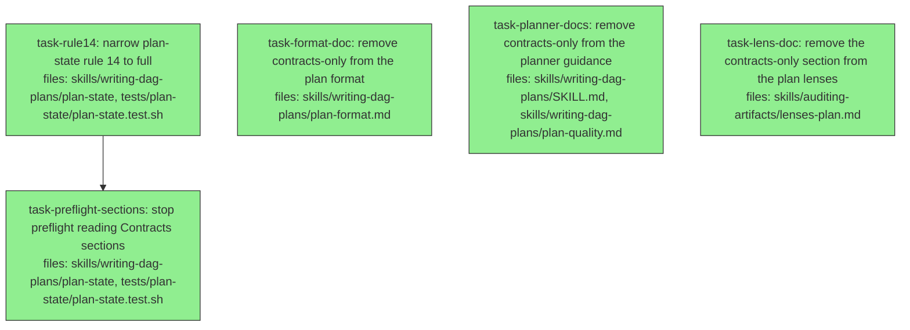

## Context

The D1 pilot (`experiments/d1-no-implementation/REPORT.md`) failed its decision rule, so the
experimental contracts-only plan format goes. Its support sits in `plan-state` (rule 14's
per-task section checks and the section bookkeeping only they use), in the planner skill, the
plan format, the plan-quality rules and the gate-2 lens catalogue. This plan removes it. Rule 14
stays, narrowed: `implementation:`, when present, must be `full`, and `contracts-only` gets a
message naming its removal.

The plan is also the first real execution of named tests (E3): both `plan-state` tasks carry a
`tests:` list in `tests/plan-state/plan-state.test.sh`, the slowest suite, so `verify-tests`
runs on them. `verify-tests` runs the task's new suite in both trees, and only the non-test
files go back to `base_sha`. A named case must therefore fail against the base script and pass
after the change; its expected label is `ok`. A case that also passes against the base script (a
preservation guard) stays in the suite but is not listed in `tests:`.

Out of scope, per the spec: anything under `experiments/`, `plan-state charter` and its
`## Contracts between children` table (a superspec charter section, a different thing with the
same word), and `verify-tests` itself.

### Calls made while planning

The spec is approved and asked for no questions; these are the planner's decisions.

1. **Preflight stops reading `## Contracts` text.** The spec left this to the builder: remove it
   only if nothing but contracts-only plans has such a section. Searching the repo for a heading
   that is exactly `## Contracts` finds it only in the two D1 contracts-only plan snapshots under
   `experiments/d1-no-implementation/final-plans/`. Superspec charters use
   `## Contracts between children`, which never matched. So it goes, in its own task
   (`task-preflight-sections`), and the suite's "four sections read" case is replaced by two new
   names, since the old name says "four" and the case now counts three.
2. **`secimpl` goes with `seccon`.** The spec names only `seccon`, but `secimpl` is set on the
   line beside it and read only by the same rule 14 loop. Leaving it would leave dead
   bookkeeping.
3. **Two more doc mentions are removed than the spec lists.** The spec's goal is "no trace in
   `skills/`". Besides the places it lists, `skills/writing-dag-plans/SKILL.md` step 7 has the
   parenthetical "(`## Contracts` under `implementation: contracts-only`)" and
   `skills/writing-dag-plans/plan-quality.md` H7 ends with a contracts-only sentence. Both go, in
   the tasks that already own those files.
4. **Rule 14's other cases.** The rewritten T21 pins: `contracts-only` with no sections and with
   a `## Contracts` section on every task both exit 1 with exactly the removal line; `bogus`
   exits 1 with exactly `implementation is bogus`; `full` and no key are clean; the removal line
   holds under the alternate shell. The other old T21 cases (wiring tasks, fenced headings, both
   sections) tested the removed checks and go with them.
5. **Shape.** The two `plan-state` tasks share the script and its suite, so they serialize. The
   three doc tasks touch disjoint files and nothing in them depends on the script's code, so
   they are roots and run beside the script work. The doc tasks restate the removal message
   exactly, so they need no edge to `task-rule14`.
6. **Script and suite in one task.** The two `plan-state` tasks list the script and its suite,
   which have different top-level directories (H3). They are one subsystem by this repo's
   convention (`CLAUDE.md`: each script has a suite under `tests/<suite>/`), and `tests:` needs
   the suite in the task's `files:`, so they are not split or marked as wiring tasks. The
   named-tests plan before this one did the same.
7. **Review.** The plan defaults to `merged` review. The two `plan-state` tasks use `split`,
   since they change a script that every plan check runs through. The doc tasks are small
   deletions and use `model_hint: cheap`.

### Final check (whole branch, after every task)

`rg -n -i 'contracts-only' skills tests` prints only: rule 14's lines in
`skills/writing-dag-plans/plan-state`, T21's lines in `tests/plan-state/plan-state.test.sh`, and
the rule 14 and frontmatter-comment lines in `skills/writing-dag-plans/plan-format.md`. And
every suite passes:

```bash
for t in tests/*/*.test.sh; do bash "$t" || exit 1; done
```

`CLAUDE.md` asks that the helper scripts run under dash and under gawk, mawk and busybox awk;
the suites cover dash through their alternate-shell cases, and the mawk and busybox awk runs
are an acceptance criterion of `task-rule14`.

## Tasks

## Task: narrow plan-state rule 14 to full

```yaml
id: task-rule14
depends_on: []
files:
  - skills/writing-dag-plans/plan-state
  - tests/plan-state/plan-state.test.sh
status: done
base_sha: e8fd7f518c5c413ec55f7dbebc94c50cac4fd070
review_mode: split
tests:
  - tests/plan-state/plan-state.test.sh :: rule 14: contracts-only names its removal
  - tests/plan-state/plan-state.test.sh :: rule 14: contracts-only with Contracts sections still exits 1
  - tests/plan-state/plan-state.test.sh :: rule 14: removal message under the alternate shell
```

In `plan-state check`, rule 14 accepts only `implementation: full`. A plan that sets
`contracts-only` gets one violation naming the format as removed after the D1 pilot; any other
value keeps today's message. The per-task `## Contracts` / `## Implementation` checks go, and so
do the two arrays that only they read: `seccon` and `secimpl` (set at
`skills/writing-dag-plans/plan-state:411` and `:412`). Keeping the field means an old plan that
says `full` still passes. Spec: "The change", first two bullets and the Tests bullet.

Leave line 413 (the preflight section regex) alone: `task-preflight-sections` owns it.

The exact lines, on stdout, with `check` exiting 1:

- `plan-state: rule 14: implementation is contracts-only (removed after the D1 pilot; use full)`
- `plan-state: rule 14: implementation is <value>` for any other value except `full`

## Implementation

```awk
# skills/writing-dag-plans/plan-state, in the check pass: replaces the block at :165-173
  if (("implementation" in fmset) && fm["implementation"] != "full")
    viol(14, "implementation is " fm["implementation"] \
      (fm["implementation"] == "contracts-only" ? " (removed after the D1 pilot; use full)" : ""))

# in the parse pass: delete these two lines (the next line, the intext regex, stays)
#  if (cur && line ~ /^## Implementation[ 	]*$/) secimpl[cur] = 1
#  if (cur && line ~ /^## Contracts[ 	]*$/) seccon[cur] = 1
```

```bash
# tests/plan-state/plan-state.test.sh: T21 rewritten (sketch; keep addsec and setimpl)
echo "T21: rule 14, implementation must be full"
gone="plan-state: rule 14: implementation is contracts-only (removed after the D1 pilot; use full)"
p1="$tmp"/r21; clean_plan "$p1"; setimpl "$p1" contracts-only
out="$(ps check "$p1" 2>&1)"; rc=$?
chk "rule 14: contracts-only names its removal" "$rc:$out" "1:$gone"
p2="$tmp"/r21b; clean_plan "$p2"; setimpl "$p2" contracts-only
for n in 1 2 3; do addsec "$p2" $n Contracts; done
out="$(ps check "$p2" 2>&1)"; rc=$?
chk "rule 14: contracts-only with Contracts sections still exits 1" "$rc:$out" "1:$gone"
```

The variable name `gone` and the fixture file names are illustrative; the helpers `clean_plan`,
`addsec`, `setimpl`, `ps`, `chk` and `$ALTSH` already exist in the suite.

## Acceptance criteria

Each quoted name below is a case in `tests/plan-state/plan-state.test.sh`, each name appears
once in the suite, and each compares `"$rc:$out"` exactly, so an extra line (a leftover per-task
rule 14 line) fails it. Only the three cases that fail against the base script are in `tests:`.
"bogus value is named", "implementation full is clean" and "no implementation key is clean" also
pass against the base script, so they are preservation guards: in the suite, not named.

- "rule 14: contracts-only names its removal": `clean_plan` plus `implementation: contracts-only`
  gives exactly `1:plan-state: rule 14: implementation is contracts-only (removed after the D1 pilot; use full)`.
- "rule 14: contracts-only with Contracts sections still exits 1": the same plan with a
  `## Contracts` section after every task's YAML block gives exactly the same `1:` line (today
  this plan passes check with exit 0).
- "rule 14: bogus value is named": `implementation: bogus` gives exactly
  `1:plan-state: rule 14: implementation is bogus`.
- "rule 14: implementation full is clean": `implementation: full` gives `0:` (exit 0, no output).
- "rule 14: no implementation key is clean": `clean_plan` unchanged gives `0:`.
- "rule 14: removal message under the alternate shell": `$ALTSH "$SCRIPT" check` on the first
  fixture gives exactly the removal `1:` line. The case name must not contain `$ALTSH`, since a
  named case must print the same name on every machine.
- The old T21 case names ("contracts-only plan without Contracts sections exits 1", "names the
  task", "both sections exits 1", "wiring task needs neither section", "fenced Contracts heading
  does not count", and the rest of the old T21 block) no longer appear in the suite.
- `rg -n 'seccon|secimpl' skills/writing-dag-plans/plan-state` prints nothing. (A source search,
  not a suite case.)
- `bash tests/plan-state/plan-state.test.sh` ends with `RESULT: N passed, 0 failed` and exits 0.
- `sh skills/executing-dag-plans/verify-tests docs/superpowers/plans/2026-11-20-remove-contracts-only.md task-rule14`
  labels all 3 entries `ok` and exits 0.
- For each of `mawk` and `busybox` that is present: in a `mktemp -d` directory `$shim`, an
  executable `awk` that runs `exec mawk "$@"` (or `exec busybox awk "$@"`), then
  `PATH="$shim:$PATH" bash tests/plan-state/plan-state.test.sh` ends with
  `RESULT: N passed, 0 failed`. The DONE report names the awks that ran and has one `NOTE:` line
  for each one that was missing.

Test file: `tests/plan-state/plan-state.test.sh`.

## Task: stop preflight reading Contracts sections

```yaml
id: task-preflight-sections
depends_on: [task-rule14]
files:
  - skills/writing-dag-plans/plan-state
  - tests/plan-state/plan-state.test.sh
status: done
base_sha: 563a90484bbc3626ed84e7563b6b0faf0f164ea8
review_mode: split
tests:
  - tests/plan-state/plan-state.test.sh :: preflight reads three sections, not Contracts
  - tests/plan-state/plan-state.test.sh :: text under ## Contracts is not read
```

`plan-state preflight` reads a task's prose, its `## Implementation` text and its
`## Acceptance criteria` text, and today also its `## Contracts` text, which existed only for
contracts-only plans. With the format gone, text under a `## Contracts` heading is no longer
read. A heading that is exactly `## Contracts` now ends the read text like any other unknown
level-2 heading. Superspec charters' `## Contracts between children` is unaffected; it never
matched and preflight does not read charters. Spec: "The change", the `plan-state` bullet's last
sentence; the decision is recorded in this plan's Context, call 1.

## Implementation

```awk
# skills/writing-dag-plans/plan-state, parse pass: the line that clears intext on a heading,
# found by content (the one with "Implementation|Contracts|Acceptance criteria"); drop Contracts
  if (line ~ /^##? / && line !~ /^## (Implementation|Acceptance criteria)[ \t]*$/) intext = 0
```

In `tests/plan-state/plan-state.test.sh`, edit the `sec.md` fixture's `printf` line (the one
after `pf_task "$pf/sec.md" task-x`): move its `## Contracts` section, with that section's one
`Use` line, from after `## Implementation` to after `### Example` and before `## Notes`. Leave
every cited path and the `pf_run` line as they are. Replace the case `chk "four sections read"`
with `chk "preflight reads three sections, not Contracts"`, same count expression, expecting
`1:3`. Add, after it, `hasnt "text under ## Contracts is not read" "$out"` with the fixture's
Contracts file name (the one starting `con`) as the third argument. The fixture's paths are
described here rather than quoted, because preflight would read a quoted fixture path as a
citation of a real file.

The count reuses the suite's existing regex (test.sh:628) unchanged. Preflight turns reading on
only at a task's YAML fence close, so a heading that clears it ends the read text for the rest
of the task. That is why `## Contracts` moves to just before `## Notes`: in the old order it
would stop the read before `## Acceptance criteria` and `### Example`. The old case "four
sections read" is replaced, not edited in place, because its name says "four" and the case now
counts three. Both named cases fail against the base script (it reads Contracts: count 4, and
`con.sh` is printed) and pass after, so each is labelled `ok`.

## Acceptance criteria

Each criterion is a case in `tests/plan-state/plan-state.test.sh` with the quoted name, and each
name appears once in the suite.

- "preflight reads three sections, not Contracts": on the reordered `sec.md` fixture (body,
  `## Implementation`, `## Acceptance criteria`, `### Example`, `## Contracts`, `## Notes`), preflight exits 1
  and the suite's existing count (the regex over the fixture's impl, con, acc and ex citations)
  is exactly 3: the citations under `## Implementation`, `## Acceptance criteria` and
  `### Example`. The regex still matches the con citation, so reading the Contracts text would
  make it 4.
- "text under ## Contracts is not read": the same output does not contain `con.sh`, while the
  case above shows the other three sections are still read.
- The existing case "text after ## Notes is not read" still passes.
- The name "four sections read" no longer appears in the suite.
- `bash tests/plan-state/plan-state.test.sh` ends with `RESULT: N passed, 0 failed` and exits 0.
- `sh skills/executing-dag-plans/verify-tests docs/superpowers/plans/2026-11-20-remove-contracts-only.md task-preflight-sections`
  labels both entries `ok` and exits 0.

Test file: `tests/plan-state/plan-state.test.sh`.

## Task: remove contracts-only from the plan format

```yaml
id: task-format-doc
depends_on: []
files:
  - skills/writing-dag-plans/plan-format.md
status: done
base_sha: e8fd7f518c5c413ec55f7dbebc94c50cac4fd070
model_hint: cheap
```

`plan-format.md` describes contracts-only in three places: the `implementation:` comment in the
frontmatter skeleton (line 29), the "Contracts-only plans (experimental)" subsection (lines
204-211), and rule 14 (line 281). Rewrite the comment and rule 14 to the narrowed rule, and
delete the subsection with its heading. Spec: "The change", Docs bullet.

## Implementation

```markdown
implementation: full                    # OPTIONAL. Only `full` is valid; the key is kept so older plans that set it still pass. contracts-only was removed after the D1 pilot (rule 14).

14. **`implementation:` mode** — `implementation:`, when present in frontmatter, MUST be `full`. `contracts-only` was removed after the D1 pilot and is refused with `plan-state: rule 14: implementation is contracts-only (removed after the D1 pilot; use full)`. Any other value → `plan-state: rule 14: implementation is <value>`.
```

```bash
# the check: before the change it lists 4 lines; after, only the comment and rule 14
rg -n -i 'contracts-only|Contracts-only' skills/writing-dag-plans/plan-format.md
```

## Acceptance criteria

- The frontmatter comment for `implementation:` says only `full` is valid and that
  contracts-only was removed after the D1 pilot; it no longer says "EXPERIMENTAL" or points to a
  "Contracts-only plans" section.
- Rule 14 reads as in the block above: `full` only, the removal message quoted exactly as
  `plan-state: rule 14: implementation is contracts-only (removed after the D1 pilot; use full)`,
  and `plan-state: rule 14: implementation is <value>` for other values. It no longer mentions
  per-task `## Contracts` or `## Implementation` sections.
- The "Contracts-only plans (experimental)" heading and its paragraph are gone; the "Wiring tasks"
  subsection is followed directly by "Example task body (canonical structure)".
- `rg -n -i 'contracts-only' skills/writing-dag-plans/plan-format.md` prints exactly two lines:
  the frontmatter comment and rule 14. `rg -n '## Contracts' skills/writing-dag-plans/plan-format.md`
  prints nothing. (Documentation searches, not suite cases.)

Test file: none; the checks are the `rg` searches above.

## Task: remove contracts-only from the planner guidance

```yaml
id: task-planner-docs
depends_on: []
files:
  - skills/writing-dag-plans/SKILL.md
  - skills/writing-dag-plans/plan-quality.md
status: done
base_sha: e8fd7f518c5c413ec55f7dbebc94c50cac4fd070
model_hint: cheap
```

The planner skill and the quality rules each tell the planner how to handle a contracts-only
plan. Remove every such passage, keeping the surrounding text intact. Spec: "The change", Docs
bullet; step 7's parenthetical and H7's last sentence are added by this plan's Context, call 3.

In `skills/writing-dag-plans/SKILL.md`:

- step 6: replace the `implementation:` bullet (lines 170-172) with the one-line bullet below;
- step 6.5 (line 191): delete "(`## Contracts` in a contracts-only plan)" and the space before it;
- step 7 (line 215): delete "(`## Contracts` under `implementation: contracts-only`)" and the
  space before it.

In `skills/writing-dag-plans/plan-quality.md`:

- H7 (line 51): delete its last sentence, which begins "Under `implementation: contracts-only`";
- delete the paragraph that begins "**Contracts-only plans (experimental).**" (line 57) and the
  blank line after it.

## Implementation

```markdown
   - `implementation:`, when present, is `full` (rule 14).
```

```bash
# the check: before the change it lists 6 lines across the two files; after, none
rg -n -i 'contracts-only|## Contracts' skills/writing-dag-plans/SKILL.md skills/writing-dag-plans/plan-quality.md
```

## Acceptance criteria

- Step 6 of `SKILL.md` has exactly the bullet "`implementation:`, when present, is `full`
  (rule 14)." in place of the old three-line bullet.
- Step 6.5 starts "Walk each task's `## Implementation` block and extract defined contract
  symbols"; step 7's H7 item reads "`## Implementation` subsection presence, import resolution".
- H7 in `plan-quality.md` ends with "they may omit the subsection entirely." and the paragraph
  after the hard-rules table begins "On any hard rule failure".
- `rg -n -i 'contracts-only|## Contracts' skills/writing-dag-plans/SKILL.md skills/writing-dag-plans/plan-quality.md`
  prints nothing, while `rg -c '## Implementation' skills/writing-dag-plans/plan-quality.md`
  still prints a non-zero count (the H7 rule itself stays). (Documentation searches, not suite
  cases.)

Test file: none; the checks are the `rg` searches above.

## Task: remove the contracts-only section from the plan lenses

```yaml
id: task-lens-doc
depends_on: []
files:
  - skills/auditing-artifacts/lenses-plan.md
status: done
base_sha: e8fd7f518c5c413ec55f7dbebc94c50cac4fd070
model_hint: cheap
```

The gate-2 lens catalogue has a "Contracts-only plans (experimental)" section (lines 25-44,
from its heading to the paragraph ending "instead.") that tells lenses not to report a missing
`## Implementation` in a contracts-only plan, changes two lenses' questions, and defines a
`needs-implementation` finding tag that nothing else in `skills/` or `agents/` uses. Delete the
section from its heading through that paragraph and the blank line after it, so the `---`
separator after the lens table is followed by the `coverage` lens section. Spec: "The change",
Docs bullet.

## Implementation

```markdown
| `ambiguity` | inherited-but-unresolved and transcription-introduced ambiguity | opus |

---

## `coverage`
```

```bash
# the check: before the change it lists 3 lines; after, none
rg -n -i 'contracts-only|## Contracts|needs-implementation' skills/auditing-artifacts/lenses-plan.md
```

## Acceptance criteria

- The heading "Contracts-only plans (experimental)" and its body (the opening paragraph, the
  "What changes per lens" list and the `needs-implementation` paragraph) are gone.
- The lens table is followed by one blank line, `---`, one blank line, then the
  `` ## `coverage` `` heading.
- `rg -n -i 'contracts-only|## Contracts|needs-implementation' skills/auditing-artifacts/lenses-plan.md`
  prints nothing, while `rg -c 'context-sufficiency' skills/auditing-artifacts/lenses-plan.md`
  still prints a non-zero count (the lens table stays). (Documentation searches, not suite
  cases.)

Test file: none; the check is the `rg` search above.

## Audit record

- **2026-11-20** · gate 2 · rev `42f17e0c5bab` · commit `a77f7fa` · lenses: coverage,
  dag-integrity, grounding, charter, context-sufficiency, verifiability, coherence,
  ambiguity (8/8 ran) · **NOT READY — 2 blocking**
  - B1 (task-rule14): three of the six named cases already pass against the base script;
    `verify-tests` keeps test files at HEAD in the before tree, so they label `not-red`
    (not `ok-absent`) and the task fails.
  - B2 (task-preflight-sections): with `sec.md` unchanged, the regex edit stops reading at
    `## Contracts`; the named case gets `1:1`, not `1:3`.
  - Joint resolution J1 covers B1, B2, D1, D2, D5; J2 owns EU1. Full set in
    `.audit/2026-11-20-remove-contracts-only.md/reconciliation.md`.
  - Deferred (not yet accepted): D1 rule 14 range ends :173 not :172; D2 stale :411
    pointer; D3 task-lens-doc before-count is 4 not 3; D4 open-ended old T21 name list;
    D5 preflight sketch regex differs from the suite's; D6 frontmatter comment keeps a
    contracts-only clause; D7 trial measurement steps unowned; D8 `plan-format.md:134` and
    reviewer prompts misdescribe `ok-absent` (out of scope, backlog).
  - Empirical unknowns opened: EU1 — mawk/busybox awk runs of the plan-state suite; owner
    task-rule14 (per J2).
