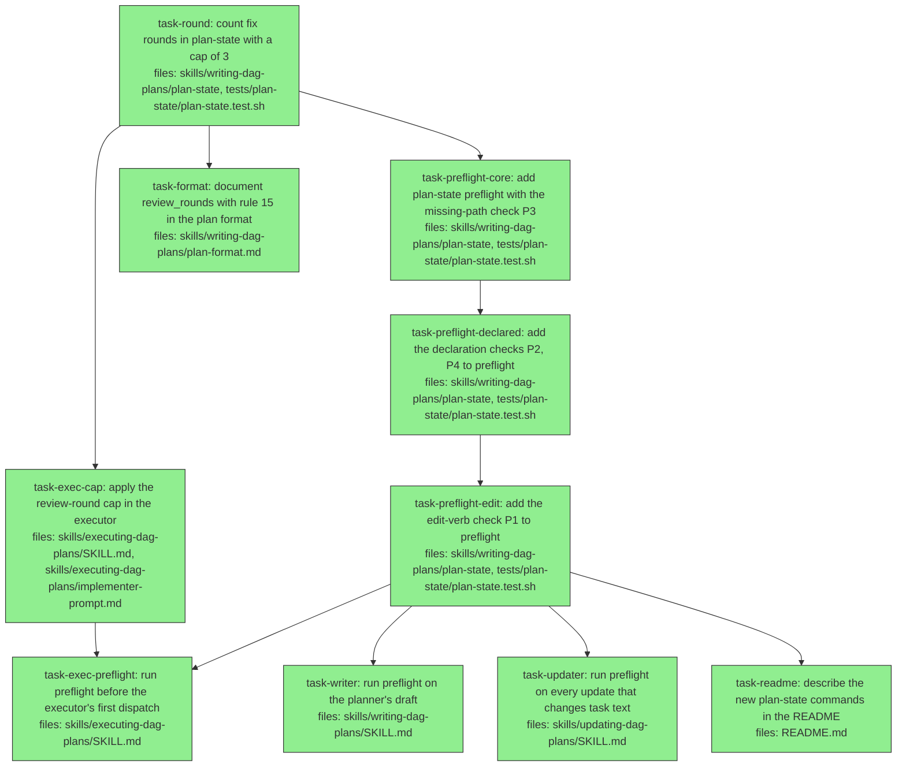

## Context

Two additions to the plugin. `plan-state preflight <plan>` reads the text of a plan's
unfinished tasks and reports four classes of path defect before anything is dispatched.
`plan-state round <plan> <id>` counts fix rounds per task in a `review_rounds:` field and
refuses at 3, so an implementer and a reviewer that disagree cannot loop without bound.
The planner, the updater and the executor are taught to call them.

Names this plan fixes, which every task below restates where it needs them: the increment
command is `round`; the cap is 3, held in one shell variable `CAP` in `plan-state`; check
rule 15 validates `review_rounds`.

Shape: the four `plan-state` tasks share the script and its test suite, so they run in a
chain (round, then preflight's core with P3, then P2 and P4, then P1). The documentation
tasks wait only for the command they describe, so the format and executor-cap tasks start
as soon as `round` lands, while preflight is still being built.

Every `plan-state` task lists the script together with its suite
`tests/plan-state/plan-state.test.sh`. They are two path prefixes but one unit: the repo
keeps each script's suite beside it in `tests/<suite>/`, and a test-first task needs both.

Repo conventions (from `CLAUDE.md`): `plan-state` is POSIX sh and awk and must run under
dash and bash, and under gawk, mawk and busybox awk: no bash-only syntax, no `gensub`,
`strftime` or `asort`, no `\x` escapes in awk. Line endings are LF. Commits use
conventional prefixes and the body says why.

## Tasks

## Task: count fix rounds in plan-state with a cap of 3

```yaml
id: task-round
depends_on: []
files:
  - skills/writing-dag-plans/plan-state
  - tests/plan-state/plan-state.test.sh
status: done
review_mode: split
```

Add a command `plan-state round <plan> <id>` that counts one fix round on a running task,
and check rule 15, which validates the count. A fix round is one re-dispatch of the
implementer after a reviewer's ISSUES verdict; the executor calls this command on every
such verdict. The count lives in an optional per-task YAML field `review_rounds: <n>`;
absent means 0. The cap is 3, held in one shell variable `CAP=3` that both `round` and
rule 15 read, passed to awk as `-v CAP="$CAP"`.

Behaviour of `round`, in this order:

1. Fewer or more than one argument after the plan: usage error, exit 2. An id that is
   absent or not unique: exit 2.
2. The task's status is not `running`: exit 2, whatever its `review_rounds` holds. This is
   checked before the value.
3. `review_rounds` holds anything but a whole number from 0 to 3: exit 2.
4. Value at 3: write nothing, print `plan-state: <id>: review cap reached (3 fix rounds)`
   on stdout, exit 1. Exit 1 means only this.
5. Otherwise write n+1 into the plan, print the new value alone on one line on stdout,
   exit 0. When the field is absent, insert `review_rounds: 1` on the line after the
   task's `status:` line, with that line's indentation and that line's line ending (CRLF
   stays CRLF). When present, rewrite its value in place.
6. Any failure to write the plan exits 2 and leaves the file's bytes as they were. The
   command maps this to 2 itself; it does not pass on the shell's status, which is 1 under
   bash for a failed redirection.

Rule 15 in `check`: `review_rounds`, when present, is a whole number from 0 to 3, else
`plan-state: rule 15: <id> review_rounds is <value>`.

Header changes: the `check` usage line reads `validate rules 1-5 and 7-15, status values,
mermaid block`; a usage line for `round` is added; the exit line becomes `Exit: 0 ok, 1
validation failure (check, charter) or cap reached (round), 2 usage error or refused
change.` `usage()` prints the header with `sed -n '3,10p'`; widen the range so the new
line prints.

`set` already rewrites only the status line, so the count survives the executor's resume
reset of `running` to `ready`. Nothing in `plan-state` lowers the count.

## Contracts

In `skills/writing-dag-plans/plan-state`: the new usage line, the exit line, the cap
variable, and the calls that carry the count.

```sh
#   plan-state round  <plan> <id>          count one fix round on a running task; exit 1 at the cap
# Exit: 0 ok, 1 validation failure (check, charter) or cap reached (round), 2 usage error or refused change.

CAP=3   # review-round cap: round refuses at it, rule 15 bounds review_rounds by it

emit [<setid> <setst> <rrid> <rrval>]   # the one write path, gains RRID and RRVAL
awk -v MODE=round -v RID=<id> -v CAP="$CAP" "$PROG" <plan>
awk -v MODE=emit -v CAP="$CAP" -v SETID=<id> -v SETST=<status> -v RRID=<id> -v RRVAL=<n> "$PROG" <plan> <plan>
```

```awk
function round()   # END calls it when MODE == "round"
```

Output of `round`:

- exit 0: the new value alone on one line, on stdout.
- exit 1: `plan-state: <id>: review cap reached (3 fix rounds)`, on stdout.
- exit 2, through `err()`: `id <id> is not unique; run: plan-state check`,
  `no task with id <id>`, `refused <id>: status is <status>, not running`, or
  `<id> review_rounds is <value>, not a whole number from 0 to 3`.
- A failed write: `plan-state: cannot write <plan>` on stderr, exit 2. This comes from
  `emit`, so `set` and `render` also exit 2 on a failed write.

## Acceptance criteria

Each bullet is a case in `tests/plan-state/plan-state.test.sh`, on a plan built inside the
test:

- Field absent, task `running`: stdout is exactly `1`, exit 0, and the line after the
  task's `status:` line is `review_rounds: 1`.
- `review_rounds: 0`, `running`: prints `1`, exit 0, and the field line now reads
  `review_rounds: 1` (still one `review_rounds` line in that task).
- `review_rounds: 2`, `running`: prints `3`, exit 0, field reads `review_rounds: 3`.
- `review_rounds: 3`, `running`: exit 1, output is
  `plan-state: task-a: review cap reached (3 fix rounds)`, and the plan's `cksum` is the
  same before and after the call.
- A task that is `pending` exits 2, and a `pending` task at `review_rounds: 3` also exits 2
  (not 1); in both cases the plan's `cksum` is the same before and after.
- `review_rounds: 4` on a `running` task: `round` exits 2, and `check` prints
  `plan-state: rule 15: task-a review_rounds is 4` and exits 1. `check` also prints a
  rule 15 line for `abc` and for `-1`, and prints nothing for `0` and `3`.
- A CRLF plan (every line ending `\r\n`, built with awk) with the field absent: after
  `round`, the inserted line is `review_rounds: 1\r` and every line of the file still ends
  in `\r`.
- A plan the command cannot write (`chmod a-w`): exit 2 and the plan's `cksum` is
  unchanged. When the suite runs as a user that can still write a read-only file (root),
  the test first probes with `( : >> "$f" ) 2>/dev/null`; if the probe succeeds it prints
  one `NOTE:` line saying the case could not be exercised, counts neither a pass nor a
  fail, and the rest of the suite still runs.
- `round` with no id, or with an extra argument, exits 2; an unknown id exits 2.
- `sh plan-state` with no arguments prints usage lines that include `round` and
  `rules 1-5 and 7-15`, and exits 2.
- The T22 cases for absent field and cap pass when the script is run under `$ALTSH` too.
- Every test that existed before this task still passes; the file ends with
  `RESULT: N passed, 0 failed` and exits 0.

Test file: `tests/plan-state/plan-state.test.sh`.

## Task: add plan-state preflight with the missing-path check P3

```yaml
id: task-preflight-core
depends_on: [task-round]
files:
  - skills/writing-dag-plans/plan-state
  - tests/plan-state/plan-state.test.sh
status: done
review_mode: split
```

Add `plan-state preflight <plan>`: it reads the text of every `pending` and `ready` task,
finds the paths that text names, and reports defects. This task builds the whole command
(text scoping, the path rule, the existence table, levels, ordering, exit codes) and its
first check, P3. Later tasks add P2, P4 and P1 to the same loop, so leave a place for them.

**Which text is read.** A task's text is every line after its YAML block closes, up to the
next `## Task:` heading or the first H1 or H2 heading (`# ` or `## `, outside a fence) that
is not exactly `## Implementation`, `## Contracts` or `## Acceptance criteria`. H3 and
deeper headings do not end it. Only `pending` and `ready` tasks' text is judged. Every
task's `files:` counts as a declaration, whatever its status.

**Candidates.** From prose lines (outside fences): each backticked span; a span containing
a space or tab is not a candidate (the token rule of
`skills/auditing-artifacts/resolve-declared-paths`). From lines inside a fenced code block:
each word, after splitting on whitespace, `"`, `'` and backticks. Bare prose outside
backticks is never read. Normalize each candidate: strip a trailing run of `.` `,` `;` `:`
`)`; then split off a line suffix `:N` or `:N-M` and keep it; then strip a leading `./`.

**Path rule.** A normalized candidate is a path when it is not excluded and either contains
`/` with a last segment ending in `.` followed by letters, digits or `_`, or equals exactly
some task's `files:` entry. Excluded: contains `*`, `?`, `<`, `>` or `{`; contains `://`;
starts with `/`; starts with `../`. So `and/or`, `7/7` and `missing/extra` are not paths.

**Existence.** Paths resolve against the repo root: the git top level of the plan's
directory, falling back to the working directory, the same expression rule 11 uses
(factor it into one shell function). A path exists when a file or a directory is there.
awk cannot stat, so the shell builds a table first: awk (`MODE=pfpaths`) prints each
unique path once; the shell writes `path<TAB>file|dir|absent<TAB>lines` per path to a
temp file (line count from `awk 'END { print NR }'`, so a last line without a newline
counts); awk (`MODE=preflight -v PFTAB=<file>`) reads it with `getline` in END.

**P3.** Skip any path in the task's own `files:`. Otherwise:
- absent and no task declares it: a line citation is an error, a bare citation a warning.
  Message: `<id> cites <citation>, which does not exist and no task creates`.
- exists and cited with a suffix: an error when it is a directory
  (`<id> cites <citation>, which is a directory`), when the suffix is `:0` or has M below N
  (`<id> cites <citation>, which is not a line range`), or when the file has fewer lines than
  the larger of N and M (`<id> cites <citation>, past the end of the file (<L> lines)`).
  `<citation>` is the path with its suffix when it has one.

**Reporting.** Each (task, path, check) is reported once, comparing paths without their
suffix. A finding takes the highest level any of its citations reaches and shows the first
citation at that level. Line format `plan-state: preflight: P<n>: <message>`, with
`warning: ` before the message for a warning, on stdout. Order: task file order, then each
path's first appearance in that task, then check id.

**Exit and check-first.** Run `check` first (move the `check)` branch into a shell
function and call it); if it fails, its violations are already printed: exit 1 without
running the checks. Otherwise exit 0 when no finding is an error, 1 when one is, 2 on a
usage error (any argument after the plan). Add a usage line
`plan-state preflight <plan>            report path defects in unfinished tasks' text`
(widen `usage()`'s `sed` range by one), and change the header exit line to
`Exit: 0 ok, 1 validation failure (check, charter), preflight error, or cap reached (round), 2 usage error or refused change.`

## Contracts

In `skills/writing-dag-plans/plan-state`:

```sh
repo_root()   # git top level of the plan's directory, else the working directory; rule 11 uses it too
run_check()   # the former check) branch; non-zero when check fails, its lines already printed

awk -v MODE=pfpaths -v CAP="$CAP" "$PROG" <plan>                    # prints each unique path once
awk -v MODE=preflight -v PFTAB=<table> -v CAP="$CAP" "$PROG" <plan>  # prints the findings; exit 0 or 1
```

The table file, one line per path:

```
<path><TAB>file<TAB><lines>
<path><TAB>dir<TAB>0
<path><TAB>absent<TAB>0
```

awk names that the later checks build on:

```awk
# ntx[t], txt[t, n], code[t, n]   task t's text lines; code is 1 for a line inside a fence
# dcl[path] = " t1 t2 ..."        indexes of the tasks declaring path in files:, in file order
# kind[path], nlines[path]        read from PFTAB
# cp[t, i], cs[t, i], nc[t]       citation i of task t: normalized path, line suffix; the count
function norm(c)                    # path part of c; the line suffix goes to SUF
function ispath(p)                  # 1 when p is a path under the path rule
function addc(t, raw)               # adds raw as a citation of t when it is a path
function cite(t, i)                 # path as cited, suffix kept
function cands(t)                   # fills t's citations from its text
function note(t, p, c, level, msg)  # level 1 warning, 2 error; the highest level is kept
function p3(t, i)                   # P3 for citation i of task t
function preflight()                # END, MODE == "preflight"; exit 1 when a finding is an error
```

## Acceptance criteria

All cases run from inside a temp directory that is not in a git repo (as T8 does), so the
root is that directory, unless the bullet says otherwise:

- Benign fixture: one pending task whose text holds `and/or`, `7/7`, `missing/extra` in
  backticks, a backticked existing path ending a sentence written with the period inside
  the backticks (`` `lib/two.sh.` ``), and inside a code block an absent, undeclared path
  with no line suffix. `preflight` exits 0 and prints no line without `warning:`; it prints
  exactly one `P3: warning:` line, for the code-block path.
- Absent, undeclared `lib/gone.sh:4` in prose: exit 1, and the line is
  `plan-state: preflight: P3: task-x cites lib/gone.sh:4, which does not exist and no task creates`.
- One task citing absent, undeclared `lib/twice.sh` first bare, then as `lib/twice.sh:7`:
  exactly one line containing `lib/twice.sh` is printed, it has no `warning:`, and it shows
  `lib/twice.sh:7`.
- Against the two-line `lib/two.sh`: `:5` is an error ending `past the end of the file (2 lines)`;
  `:2-5` is an error; `:0` and `:3-1` are errors ending `which is not a line range`; `:2`
  and `:1-2` print nothing for that path.
- A directory named `data/v1.d` cited as `data/v1.d:3` is an error ending
  `which is a directory`; cited bare it prints nothing.
- A task citing its own declared, absent `lib/new.sh:9` prints nothing for it, while a
  second task citing `lib/gone.sh:4` in the same plan still prints its P3 error.
- A `done` task citing `lib/gone.sh:4` prints nothing, while a `pending` task in the same
  plan with the same text prints the P3 error.
- Text after a `## Notes` heading that follows a task is not read (an absent `path:N`
  there prints nothing); text under that task's `## Implementation`, `## Contracts`,
  `## Acceptance criteria` and an `### Example` heading is read (one absent `path:N` in each
  prints four P3 errors).
- Two absent `path:N` citations in one task print in the order they first appear in its
  text.
- A plan that fails `check` (a cycle): exit 1, output contains `rule 2:` and no
  `preflight: P` line.
- `preflight` with an extra argument exits 2.
- Real plans: copy `docs/superpowers/plans/2026-08-27-seams-and-ground-truth-dag.md` and
  `docs/superpowers/plans/2026-11-12-d1-prerequisites-dag.md` to the temp directory with
  every `status: done` rewritten to `status: pending` (both are all `done` as committed, so
  as written preflight would read none of their text). Run `preflight` on each copy with
  the working directory at the repo root (`cd "$REPO"`), so its paths resolve against this
  repo. For each: stderr is empty, the exit code is 0 or 1, and when it is 1 the output
  holds at least one `preflight: P` line.
- The absent `path:N` case gives the same output under `$ALTSH`.
- Every earlier test still passes; the file ends with `RESULT: N passed, 0 failed`.

Test file: `tests/plan-state/plan-state.test.sh`.

## Task: add the declaration checks P2, P4 to preflight

```yaml
id: task-preflight-declared
depends_on: [task-preflight-core]
files:
  - skills/writing-dag-plans/plan-state
  - tests/plan-state/plan-state.test.sh
status: done
review_mode: split
```

`plan-state preflight` already reads unfinished tasks' text, extracts paths, builds the
existence table (`kind[path]` is `file`, `dir` or `absent`), keeps `dcl[path]` (the
indexes of every task declaring the path in `files:`, in plan order), skips a path the task
itself declares, and reports through `note(t, path, check, level, message)` (level 1
warning, 2 error; the first citation at the highest level wins). Add two checks to that
loop. Use `ancestors()` (`anc[t, u]` is 1 when `u` is a transitive ancestor of `t`); `u`
is a descendant of `t` when `anc[u, t]`.

**P2** (error, or warning). The path is absent, some other task declares it, and no task
that declares it is this task or one of its ancestors. A warning when every declarer is a
descendant of this task, since depending on a descendant would make a cycle; otherwise an
error.
- Error message: `<id> uses <citation>, which <other id> declares, but does not depend on <other id>`,
  where `<other id>` is the first declarer in plan order that is not a descendant.
- Warning message: `<id> uses <citation>, which <other id> declares, but <other id> depends on <id>`,
  where `<other id>` is the first declarer in plan order. It must not suggest adding a
  dependency, because that dependency would close a cycle.

**P4** (warning). The path exists, another task whose status is `pending`, `ready` or
`running` declares it, and there is no dependency path between the two in either
direction. Message: `<id> reads <citation> while <other id>, which can run at the same time, changes it`,
naming the first such declarer in plan order.

`<citation>` is the path with its line suffix when the first citation has one. Order
within a path stays by check id, so a P2 line comes before a P3 or P4 line for the same
path.

## Contracts

```awk
function p2(t, i)   # P2 for citation i of task t; reports through note(t, p, 2, level, msg)
function p4(t, i)   # P4 for citation i of task t; reports through note(t, p, 4, 1, msg)
```

Both are called from the per-citation loop of `preflight()`, beside `p3(t, i)`.

## Acceptance criteria

Fixtures run from a temp directory outside any git repo, as in T23:

- Siblings: `task-x` cites absent `lib/made.sh`, which root task `task-y` declares: exit 1
  with the P2 error line above, naming `task-y`. When `task-x` gains
  `depends_on: [task-y]`, the same plan prints no line for `lib/made.sh`.
- Grand-ancestor: `task-z` depends on `task-x`, which depends on `task-y`; `task-z` citing
  `lib/made.sh` prints no line for it.
- Descendant only: `task-y` depends on `task-x`, `task-y` declares `lib/made.sh`, `task-x`
  cites it: exit 0 and one line,
  `plan-state: preflight: P2: warning: task-x uses lib/made.sh, which task-y declares, but task-y depends on task-x`.
- Mixed: declarers in plan order are `task-d` (a descendant of `task-x`) then `task-s` (a
  sibling): exit 1, the line is an error and names `task-s`, not `task-d`.
- The fixture from T23's absent-`path:N` case, extended with a non-ancestor declaring a
  second absent path that `task-x` cites, prints both a P3 error and a P2 error in one run.
- P4: `lib/two.sh` exists; root tasks `task-x` (cites it) and `task-w` (`pending`,
  declares it): exit 0 and the line
  `plan-state: preflight: P4: warning: task-x reads lib/two.sh while task-w, which can run at the same time, changes it`.
  With `task-w` set to `done`, or with `task-x` depending on `task-w`, no P4 line is printed
  for that path; with `task-w` `running`, the P4 line is printed.
- For one path that draws both P2 and P3 lines in a task, P2 prints first.
- The P2 sibling case gives the same output under `$ALTSH`.
- Every earlier test, including T23's real-plan cases, still passes; the file ends with
  `RESULT: N passed, 0 failed`.

Test file: `tests/plan-state/plan-state.test.sh`.

## Task: add the edit-verb check P1 to preflight

```yaml
id: task-preflight-edit
depends_on: [task-preflight-declared]
files:
  - skills/writing-dag-plans/plan-state
  - tests/plan-state/plan-state.test.sh
status: done
review_mode: split
```

`plan-state preflight` reads unfinished tasks' text, extracts candidate paths line by
line (`cands(t)` fills `cp[t, i]`, the normalized path, and `cs[t, i]`, its line suffix),
skips a path the task declares, and reports through `note(t, path, check, level, message)`.
Add P1, a warning: a path appears on the same line as, and after, an edit verb, and the
path is not in this task's `files:`. Message:
`<id> says to edit <citation>, which is not in its files:`.

This catches a task whose text says "Rename the function `greet` to `say_hello` in
`lib/greet.sh`" while its `files:` holds only `docs/usage.md`.

Edit verbs, any case, any of these forms, matched as whole words: edit, edits, edited,
editing; modify, modifies, modified, modifying; change, changes, changed, changing; update,
updates, updated, updating; rename, renames, renamed, renaming; delete, deletes, deleted,
deleting; remove, removes, removed, removing; replace, replaces, replaced, replacing;
rewrite, rewrites, rewrote, rewritten, rewriting; add to, adds to, added to, adding to;
append to, appends to, appended to, appending to. A verb directly preceded by `not`,
`never` or a word ending `n't` ("do not edit", "never modify", "don't change") does not
count. A line where a negated verb is followed by a plain one still counts the plain one.

To know what came before the path, `cands` records each citation's line prefix: the text
of its line before the candidate starts (`cpre[t, i]`).

## Contracts

```awk
function addc(t, raw, pre)   # pre, the text of the line before the candidate, is stored as cpre[t, i]
function editverb(s)         # 1 when s holds a non-negated edit verb, else 0
function p1(t, i)            # P1 for citation i of task t; reports through note(t, p, 1, 1, msg)
```

`p1` is called from the per-citation loop of `preflight()`, beside `p2`, `p3` and `p4`.

## Acceptance criteria

Fixtures run from a temp directory outside any git repo, as in T23; `lib/greet.sh` exists
there unless a bullet says otherwise:

- The rename case above: exit 0 and exactly that P1 line.
- The same text with `lib/greet.sh` absent and undeclared: exit 0, and the P1 line prints
  before the `P3: warning:` line for the same path.
- Each of `Updated`, `MODIFY`, `rewrote`, `appends to` before the path prints a P1 line;
  `Do not edit`, `Never modify` and `Don't change` before the path print none, and
  `Do not edit the header; update` before the path prints one.
- The path before the verb on its line (`` `lib/greet.sh` is updated by the hook ``) prints no
  P1 line; the verb on the line above the path prints none.
- A verb inside a code block (`# update lib/greet.sh`) before the path prints a P1 line.
- The task declaring `lib/greet.sh` in `files:` prints no P1 line for it.
- Words that merely contain a verb (`changelog`, `editor`, `preupdate`) before the path
  print no P1 line.
- The rename case gives the same output under `$ALTSH`.
- Every earlier test, including T23's real-plan cases, still passes; the file ends with
  `RESULT: N passed, 0 failed`.

Test file: `tests/plan-state/plan-state.test.sh`.

## Task: document review_rounds with rule 15 in the plan format

```yaml
id: task-format
depends_on: [task-round]
files:
  - skills/writing-dag-plans/plan-format.md
status: done
```

Document the optional per-task field `review_rounds` and validation rule 15 in
`skills/writing-dag-plans/plan-format.md`. `plan-state round <plan> <id>` now exists: on a
`running` task below 3 it writes n+1 and prints it (exit 0); at 3 it writes nothing,
prints `plan-state: <id>: review cap reached (3 fix rounds)` and exits 1; anything else
exits 2. `plan-state check` enforces rule 15.

## Contracts

Five edits to `skills/writing-dag-plans/plan-format.md`:

1. "Per-task frontmatter schema", after the `is_wiring_task:` line of the YAML block, the
   field line:

```yaml
review_rounds: 0       # OPTIONAL. Whole number 0-3. Fix rounds so far: re-dispatches of the implementer after a reviewer's ISSUES verdict. Absent = 0. Written by `plan-state round`; nothing lowers it.
```

2. "Validation rules", after rule 14: rule 15, a line starting
   `` 15. **`review_rounds` count** — ``.
3. "Rules #7–#14 use the same refusal-message format" becomes "Rules #7–#15 use the same
   refusal-message format".
4. "enforces rules 1–5 and 7–14" becomes "enforces rules 1–5 and 7–15"; the same paragraph
   gains a sentence naming `plan-state round` and rule 15.
5. "Status semantics": the `failed` row's meaning gains the review-cap case, a reviewer's
   fourth ISSUES verdict after 3 fix rounds (rule 15).

## Acceptance criteria

- `rg -c '^15\. \*\*`review_rounds` count\*\*' skills/writing-dag-plans/plan-format.md`
  prints `1`, and that line contains `0 to 3` and `plan-state round`.
- `rg -c '^review_rounds: 0 +# OPTIONAL' skills/writing-dag-plans/plan-format.md` prints
  `1`.
- `rg -c 'Rules #7–#15' skills/writing-dag-plans/plan-format.md` prints `1` and
  `rg -c 'rules 1–5 and 7–15' skills/writing-dag-plans/plan-format.md` prints `1`;
  `rg -c 'Rules #7–#14|rules 1–5 and 7–14' skills/writing-dag-plans/plan-format.md` prints
  nothing.
- The `failed` row of the status table contains `fourth ISSUES verdict`.

Test file: none (the `rg` checks above).

## Task: apply the review-round cap in the executor

```yaml
id: task-exec-cap
depends_on: [task-round]
files:
  - skills/executing-dag-plans/SKILL.md
  - skills/executing-dag-plans/implementer-prompt.md
status: done
```

Teach the executor the review-round cap. Today a reviewer's ISSUES verdict re-dispatches
the implementer with no bound. From now on, on every ISSUES verdict the controller runs
`plan-state round <plan> <id>` and acts on its exit code alone. That command exists: on a
`running` task with fewer than 3 fix rounds it records one more and prints the new count
(exit 0); at 3 it writes nothing, prints `plan-state: <id>: review cap reached (3 fix rounds)`
and exits 1; any other failure exits 2. The count lives in the task's `review_rounds:`
field. The controller never reads or compares the count itself.

## Contracts

In `skills/executing-dag-plans/SKILL.md`:

1. The three ISSUES lines of the two review-chain diagrams become:
   - `→ ISSUES → plan-state round → exit 0: re-dispatch implementer with quality feedback → loop`
   - `→ ISSUES → plan-state round → exit 0: re-dispatch implementer with spec feedback → loop`
   - `→ EITHER verdict ISSUES → plan-state round → exit 0: re-dispatch implementer with the combined feedback → merged re-review → loop`
2. A new paragraph after "Reading a verdict", starting `**Review-round cap.**`.
3. A row in the "Implementer status handling" table, after BLOCKED, starting
   `| **ISSUES** (a reviewer's verdict) |`.

In `skills/executing-dag-plans/implementer-prompt.md`: a paragraph under "Re-dispatch on
review issues", after the first sentence.

Commands the new text names: `plan-state round <plan> <id>` and
`plan-state set <plan> <id> failed`.

## Acceptance criteria

- `rg -c '^\*\*Review-round cap\.\*\*' skills/executing-dag-plans/SKILL.md` prints `1`, and
  that paragraph names all three exit codes of `plan-state round` with their actions
  (re-dispatch, `plan-state set <plan> <id> failed`, halt), the cap of 3, and both
  non-rounds (the malformed-report reviewer re-run and the post-restart dispatch).
- `rg -c 'ISSUES → plan-state round → exit 0: re-dispatch implementer' skills/executing-dag-plans/SKILL.md`
  prints `3`, and `rg -c 'ISSUES → re-dispatch implementer' skills/executing-dag-plans/SKILL.md`
  prints nothing (no ISSUES line skips the call).
- The status-handling table has a row starting `| **ISSUES**` that contains
  `plan-state round` and `failed`.
- `rg -c 'plan-state round' skills/executing-dag-plans/implementer-prompt.md` prints `1`
  or more, inside the "Re-dispatch on review issues" section (between that heading and
  "## Re-dispatch on BLOCKED").
- The text says the controller never reads or compares the count:
  `rg -c 'never read or compare the count' skills/executing-dag-plans/SKILL.md` prints `1`.

Test file: none (the `rg` checks above).

## Task: run preflight before the executor's first dispatch

```yaml
id: task-exec-preflight
depends_on: [task-exec-cap, task-preflight-edit]
files:
  - skills/executing-dag-plans/SKILL.md
status: done
```

Make the executor run `plan-state preflight <plan>` on every invocation, at start and on
resume, before it dispatches anything. That command exists: it runs `check` first (a
`check` failure prints check's violations and exits 1), then reports path defects in the
text of `pending` and `ready` tasks, one line each,
`plan-state: preflight: P<n>: [warning: ]<message>`. Exit 0 means no errors (warnings may
print); 1 means at least one error; 2 a usage error. The four checks: P1 (warning) a path
the text says to edit that is not in the task's `files:`; P2 (error, or warning) a missing
path another task creates without a dependency path to it; P3 (error for a line citation,
warning otherwise) a missing path no task creates, or a line citation past the end of its
file; P4 (warning) a path another task that can run at the same time changes.

## Contracts

In `skills/executing-dag-plans/SKILL.md`:

1. Text appended to the "Pre-flight check" paragraph, naming `plan-state preflight <plan>`.
2. "Resumability": the `running` bullet gains a closing sentence naming
   `plan-state preflight` and the Pre-flight check.

## Acceptance criteria

- `rg -c 'plan-state preflight' skills/executing-dag-plans/SKILL.md` prints `2` or more:
  one in the "Pre-flight check" paragraph and one in the `running` bullet of
  "Resumability".
- The Pre-flight check paragraph says, for preflight: it runs on every invocation at start
  and on resume; on resume, after `running` tasks are reset to `ready`; exit 1 halts before
  any dispatch with no status change; `warning:` lines are printed and the run proceeds;
  exit 2 halts.
- Preflight is an item in the Pre-flight check paragraph, not a new numbered step:
  `rg -c '^[0-9]+\. ' skills/executing-dag-plans/SKILL.md` prints `12`, and the dispatch
  loop's steps are still numbered 1 to 7.
- The "Review-round cap" paragraph from the earlier task is still present:
  `rg -c '^\*\*Review-round cap\.\*\*' skills/executing-dag-plans/SKILL.md` prints `1`.

Test file: none (the `rg` checks above).

## Task: run preflight on the planner's draft

```yaml
id: task-writer
depends_on: [task-preflight-edit]
files:
  - skills/writing-dag-plans/SKILL.md
status: done
```

Make `writing-dag-plans` run `plan-state preflight` on the draft right after
`plan-state check` in step 6. That command exists: it runs `check` first, then reports
path defects in the text of `pending` and `ready` tasks (every task in a draft is
`pending`), one line each, `plan-state: preflight: P<n>: [warning: ]<message>`; exit 0
means no errors, 1 at least one error, 2 a usage error. An error refuses the draft, as a
`check` violation does. Warnings join the soft-heuristic warnings and the author confirms
or revises.

## Contracts

In `skills/writing-dag-plans/SKILL.md`, step 6, after the paragraph that ends "the final
path is written only in step 11.": an indented paragraph that runs
`sh ./plan-state preflight <draft>`.

## Acceptance criteria

- `rg -c 'sh ./plan-state preflight <draft>' skills/writing-dag-plans/SKILL.md` prints `1`,
  and the line is inside step 6: after the line containing `sh ./plan-state check <draft>`
  and before the line starting `6.5.`.
- The inserted text says an error refuses the draft and that `warning:` lines join step 7's
  soft warnings under "save anyway? (y/N)".
- No step was added or renumbered: `rg -c '^[0-9]+(\.[0-9]+)?\. \*\*' skills/writing-dag-plans/SKILL.md`
  prints `15`.

Test file: none (the `rg` checks above).

## Task: run preflight on every update that changes task text

```yaml
id: task-updater
depends_on: [task-preflight-edit]
files:
  - skills/updating-dag-plans/SKILL.md
status: done
```

Make `updating-dag-plans` run `plan-state preflight` for every operation that adds a task,
changes a task's body, `files:` or `depends_on:`, or removes a task, and state that no
operation changes `review_rounds`. `plan-state preflight <plan>` exists: it runs `check`
first (a `check` failure prints check's violations and exits 1 with no `preflight:` lines),
then prints one line per finding, `plan-state: preflight: P<n>: [warning: ]<message>`,
where the message starts with the task id and names the path, and exits 0 (no errors),
1 (an error) or 2 (usage). A finding is identified by (check id, task id, path without its
`:N` suffix). `review_rounds:` is a per-task YAML field counting fix rounds; nothing may
lower it.

## Contracts

In `skills/updating-dag-plans/SKILL.md`:

1. "Operations supported", the **Modify body** row: "No re-validation needed." becomes
   "No structural re-validation needed, except `plan-state preflight` (step 5)."
2. Step 5: "It covers these rules and rules 7–12" becomes "It covers these rules and rules
   7–15", and an indented paragraph after it runs
   `sh ../writing-dag-plans/plan-state preflight` on the copy and on the plan as it was
   before the edit.
3. After the table in "Operations supported": a paragraph starting
   `` No operation changes a task's `review_rounds:` field. ``

## Acceptance criteria

- `rg -c 'preflight' skills/updating-dag-plans/SKILL.md` prints `2` or more: the Modify body
  row contains `preflight`, and step 5 contains the inserted paragraph.
- The step 5 paragraph names all five triggering operations (adds a task, body, `files:`,
  `depends_on:`, removes a task), runs preflight on both the copy and the plan before the
  edit, states both refusal conditions, and says every error counts as new when the plan
  before the edit fails `check`.
- `rg -c 'rules 7–15' skills/updating-dag-plans/SKILL.md` prints `1` and
  `rg -c 'rules 7–12' skills/updating-dag-plans/SKILL.md` prints nothing.
- `rg -c '^No operation changes a task' skills/updating-dag-plans/SKILL.md` prints `1`, and
  that line names `review_rounds:` and says Modify body leaves the field in place.

Test file: none (the `rg` checks above).

## Task: describe the new plan-state commands in the README

```yaml
id: task-readme
depends_on: [task-preflight-edit]
files:
  - README.md
status: done
```

Mention the review-round cap and the pre-dispatch check in `README.md`. Facts to state:
before dispatch, and on every resume, the executor runs `plan-state preflight`, which
reports path defects in unfinished tasks' text, and an error there halts the run before
anything is dispatched; a task whose review returns ISSUES after its third fix round is
marked `failed`, and the failure cascades as any other does. Both commands exist in
`skills/writing-dag-plans/plan-state`: `preflight <plan>` and `round <plan> <id>`.

## Contracts

In `README.md`:

1. "Skills", the `executing-dag-plans` bullet: a passage before "Halt-downstream on
   failure" naming `plan-state preflight` and the cap of 3 fix rounds.
2. "Testing", the `plan-state` paragraph ("does the plan bookkeeping that has one right
   answer: ...") lists two more jobs: "the pre-dispatch path check (`preflight`)" and "the
   review-round count (`round`)".

## Acceptance criteria

- `rg -c 'plan-state preflight' README.md` prints `1` or more, on the `executing-dag-plans`
  bullet line.
- `rg -c '3 fix rounds' README.md` prints `1`, on the same bullet, together with `failed`.
- The `plan-state` paragraph under "Testing" contains both `` (`preflight`) `` and
  `` (`round`) ``.

Test file: none (the `rg` checks above).
