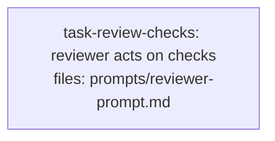

<!--
RULE: S18 (soft — warn and confirm)
EXPECTED: PASS (no S18 warning)
PAIRED WITH: ../should-warn/s18-section-reads-undelivered-field.md. The same task, which
  also delivers `checks:` to the reviewer: it adds `checks:` to the MUST-receive line and
  renders it under `## Task`.
-->

---
title: s18-fixture-pass
created: 2026-11-18
---



## Context

This is the S18 fixture. `prompts/reviewer-prompt.md` is the template a controller fills in to
dispatch a reviewer. Today it reads, in full:

```markdown
# Reviewer prompt

The reviewer MUST receive: the task's id, its `files:` list, and its body (everything after
the YAML block).

## Task

Task {task.id}. Files: {task.files}.

{task.body}

## Your verdict

APPROVED or ISSUES, with one line per issue.
```

Tasks may now carry a `checks:` list in their YAML block. The one task below teaches the
reviewer to act on it, and also delivers the list. S18 must not warn.

## Tasks

## Task: reviewer acts on checks

```yaml
id: task-review-checks
depends_on: []
files: [prompts/reviewer-prompt.md]
status: pending
```

Teach the reviewer to verify each declared check, and give it the checks.

## Implementation

Make three edits to `prompts/reviewer-prompt.md`:

1. In the MUST-receive line, after "and its body (everything after the YAML block)", add
   ", and its `checks:` entries when present".
2. Under `## Task`, after the `Task {task.id}. Files: {task.files}.` line, add:

   ```markdown
   Checks:
   {for each entry in task.checks: "  - " + entry}
   {if task has no checks: omit the two lines above}
   ```

3. Right before `## Your verdict`, add:

   ```markdown
   ## Declared checks

   If the Task section above lists `Checks:`, run each entry and report ISSUES for any that
   fails.
   ```

## Acceptance criteria

- `rg -c '^## Declared checks' prompts/reviewer-prompt.md` prints `1`, and the heading comes
  before `## Your verdict`.
- `rg -c 'checks:. entries when present' prompts/reviewer-prompt.md` prints `1`.
- `rg -c 'for each entry in task.checks' prompts/reviewer-prompt.md` prints `1`, on a line
  between `^## Task` and `^## Declared checks`.
