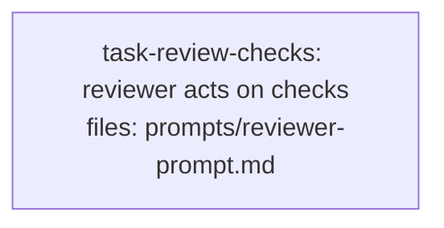

<!--
RULE: S18 (soft — warn and confirm)
EXPECTED: WARN
EXPECTED OUTPUT (substring match): "never given". This is the root of S18's own rule
  name ("prompt reads an input its reader is never given").
PAIRED WITH: ../should-pass/s18-section-reads-delivered-field.md. The only difference is
  that the should-pass task also delivers `checks:` to the reviewer.
SOURCE: the D2 experiment's F3 (experiments/d2-gate2-ablation/REPORT.md), reduced to one
  task.
-->

---
title: s18-fixture
created: 2026-11-18
---



## Context

This is the S18 fixture. `prompts/reviewer-prompt.md` is the template a controller fills in to
dispatch a reviewer. Today it reads, in full:

```markdown
# Reviewer prompt

The reviewer MUST receive: the task's id, its `files:` list, and its body (everything after
the YAML block).

## Task

Task {task.id}. Files: {task.files}.

{task.body}

## Your verdict

APPROVED or ISSUES, with one line per issue.
```

Tasks may now carry a `checks:` list in their YAML block. The one task below teaches the
reviewer to act on it, and changes nothing else. No task in the plan delivers `checks:` to the
reviewer, so S18 must warn once, naming `checks:`.

## Tasks

## Task: reviewer acts on checks

```yaml
id: task-review-checks
depends_on: []
files: [prompts/reviewer-prompt.md]
status: pending
```

Teach the reviewer to verify each declared check.

## Implementation

Add this section to `prompts/reviewer-prompt.md`, right before `## Your verdict`:

```markdown
## Declared checks

If your task's YAML block has a `checks:` list, run each entry and report ISSUES for any that
fails.
```

## Acceptance criteria

- `rg -c '^## Declared checks' prompts/reviewer-prompt.md` prints `1`.
- The `## Declared checks` heading comes before `## Your verdict`.
